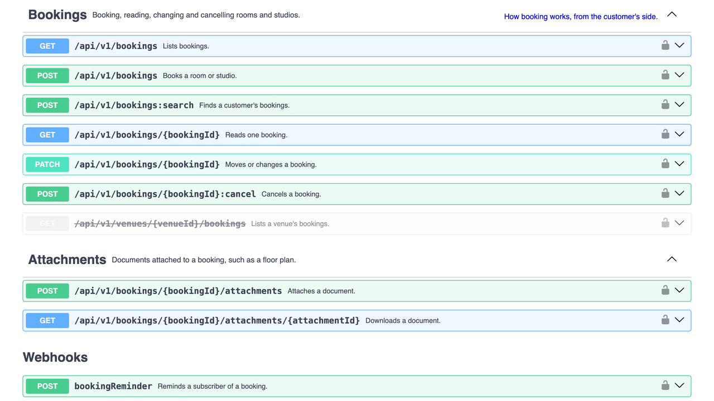
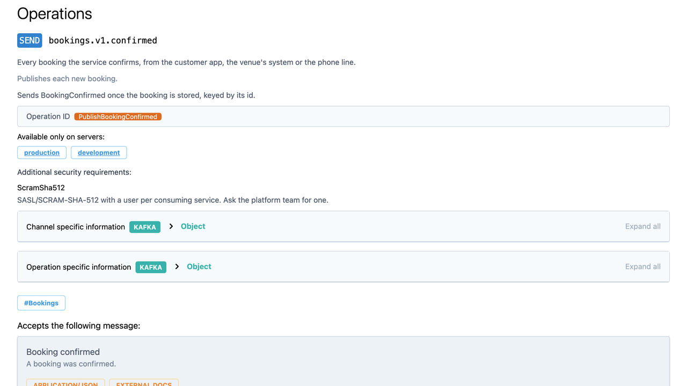
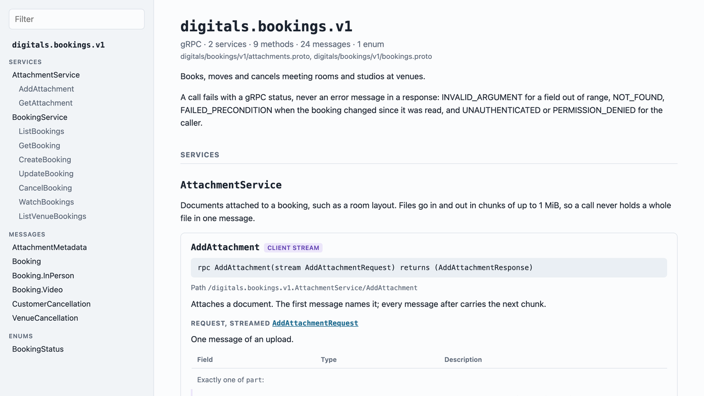
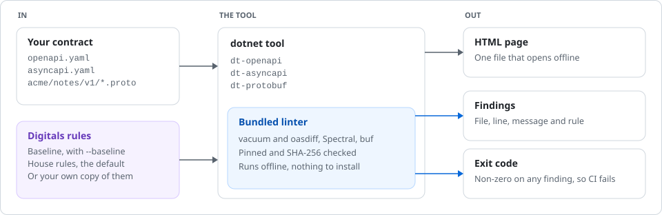

<h1 align="center">Digitals API Conventions</h1>

<p align="center">
  Lint, compare and document API contracts against the Digitals rules.<br>
  One dotnet tool per contract format. The linters come bundled, so there is nothing else to install.
</p>

<p align="center">
  <a href="https://www.nuget.org/packages/Digitals.OpenApi"></a>
  <a href="https://www.nuget.org/packages/Digitals.AsyncApi"></a>
  <a href="https://www.nuget.org/packages/Digitals.Protobuf"></a>
  <br>
  <a href="https://github.com/Digitals-OYT-Ltd/api-conventions/actions/workflows/openapi.yml"></a>
  <a href="https://github.com/Digitals-OYT-Ltd/api-conventions/actions/workflows/asyncapi.yml"></a>
  <a href="https://github.com/Digitals-OYT-Ltd/api-conventions/actions/workflows/protobuf.yml"></a>
  
  <a href="LICENSE"></a>
</p>

<p align="center">
  <a href="#quick-start">Quick start</a> ·
  <a href="#the-tools">The tools</a> ·
  <a href="#docs-pages-that-open-from-a-file">Docs pages</a> ·
  <a href="#run-it-in-ci">CI</a> ·
  <a href="#two-rule-levels">Rules</a> ·
  <a href="#contributing">Contributing</a>
</p>

<p align="center">
  <picture>
    <source media="(prefers-color-scheme: dark)" srcset="docs/images/lint-dark.svg">
    
  </picture>
</p>

A contract is the first thing we write for an API and the thing every consumer reads. These tools check that every contract follows the Digitals API conventions the same way. Each one runs an open-source linter with our rules, fails CI with that linter's exit code, and writes a documentation page you can send as an attachment.

- **One install per format.** vacuum, oasdiff, Spectral, buf and protoc-gen-doc ship inside the package for your platform. No Node, Go or Docker on the build agent.
- **The same result everywhere.** Every bundled binary is pinned and checked against its SHA-256 when the package is built, so a laptop and CI run the same linter with the same rules.
- **Works on any contract.** Point it at a path or a URL. `--baseline` audits an API that was never built to our conventions.
- **Documentation without a server.** `swagger` and `docs` inline the viewer and the contract into one HTML file that opens with no network.

## Quick start

Add the tool to the repo's tool manifest, so every developer and CI agent runs the same version:

```bash
dotnet new tool-manifest                      # once per repo
dotnet tool install Digitals.OpenApi          # or Digitals.AsyncApi, Digitals.Protobuf

dotnet dt-openapi lint contract/openapi.yaml  # exit 1 on any finding
dotnet dt-openapi swagger contract/openapi.yaml
```

Catch a breaking change before it ships:

```console
$ dotnet dt-openapi breaking main.yaml contract/openapi.yaml
1 changes: 1 error, 0 warning, 0 info
error   [api-path-removed-without-deprecation] at main.yaml
        in API POST /api/v1/bookings/{bookingId}:cancel
                api path removed without deprecation
```

Removing an operation needs it deprecated first, with an `x-sunset` date at least 180 days out that has since passed.

## The tools

| | [`dt-openapi`](src/Digitals.OpenApi/README.md) | [`dt-asyncapi`](src/Digitals.AsyncApi/README.md) | [`dt-protobuf`](src/Digitals.Protobuf/README.md) |
| --- | --- | --- | --- |
| Contract | OpenAPI 3.0 and 3.1 | AsyncAPI 2 and 3 | `.proto` files |
| For | HTTP APIs | Events and messages | gRPC |
| Lint, baseline and house rules | `lint` | `lint` | `lint` |
| Every rule explained | [OpenAPI rules](docs/rules/openapi.md) | [AsyncAPI rules](docs/rules/asyncapi.md) | [Protobuf rules](docs/rules/protobuf.md) |
| Formatting | | | `format`, `--write` fixes it |
| Breaking changes | `breaking` | | `breaking` |
| Design against implementation | `diff` | | |
| Changelog | `changelog` | | |
| Report | `report` (HTML), `dashboard` (terminal) | | |
| Docs page | `swagger` (Swagger UI) | `docs` (AsyncAPI viewer) | `docs` (our own viewer) |
| Print or extend the rules | `ruleset` | `ruleset` | `ruleset` |
| Bundled | vacuum, oasdiff, Swagger UI | Spectral, AsyncAPI React | buf, protoc-gen-doc |
| Raw access | `vacuum`, `oasdiff` | `spectral` | `buf` |

Every rule has its own section on the rules page for [OpenAPI](docs/rules/openapi.md), [AsyncAPI](docs/rules/asyncapi.md) or [Protobuf](docs/rules/protobuf.md): why it exists, a failing and a passing example, and the message the linter prints.

## Docs pages that open from a file

`dt-openapi swagger`, `dt-asyncapi docs` and `dt-protobuf docs` write a single HTML file with the viewer, its styles and the contract inlined. It opens offline, from an email attachment or a CI artifact.

<table>
  <tr>
    <td width="33%"></td>
    <td width="33%"></td>
    <td width="33%"></td>
  </tr>
  <tr>
    <td><code>dt-openapi swagger</code><br><a href="examples/openapi.yaml">examples/openapi.yaml</a></td>
    <td><code>dt-asyncapi docs</code><br><a href="examples/asyncapi.yaml">examples/asyncapi.yaml</a></td>
    <td><code>dt-protobuf docs</code><br><a href="examples/protobuf/">examples/protobuf/</a></td>
  </tr>
</table>

The three examples describe the same bookings service, for meeting rooms and studios, as an HTTP API, as events and as gRPC. Each passes every rule of its tool, so copy from them when you write a contract.

## Run it in CI

The tools exit with the bundled linter's code, so a finding fails the step. Options after the arguments go straight to that linter, which is how you get inline annotations on a pull request:

```yaml
- uses: actions/checkout@v5
  with:
    fetch-depth: 0          # the breaking checks read main
- uses: actions/setup-dotnet@v5
  with:
    global-json-file: global.json
- run: dotnet tool restore

# HTTP API
- run: dotnet dt-openapi lint contract/openapi.yaml --github-annotations
- run: git show origin/main:contract/openapi.yaml > "$RUNNER_TEMP/main.yaml"
- run: dotnet dt-openapi breaking "$RUNNER_TEMP/main.yaml" contract/openapi.yaml

# Events
- run: dotnet dt-asyncapi lint contract/asyncapi.yaml --format github-actions

# gRPC
- run: dotnet dt-protobuf lint proto --error-format github-actions
- run: dotnet dt-protobuf format proto
- run: git worktree add --detach "$RUNNER_TEMP/main" origin/main
- run: dotnet dt-protobuf breaking "$RUNNER_TEMP/main/proto" proto
```

A usage error exits 2. buf exits 100 on a finding.

## Two rule levels

Every tool ships two rule sets, and any rule left on fails `lint`.

| Level | Use it for | How |
| --- | --- | --- |
| Baseline | An existing API: a valid contract, the OWASP API Security Top 10, documented operations and errors, valid examples, no personal data in a URL | `--baseline` |
| House rules | A new contract: the baseline plus the Digitals conventions for resources, naming, paging, concurrency, errors and documentation | the default |

Each rules page draws its two levels topic by topic, with a badge on every rule saying which level it belongs to.

To change a rule for one repo, write the rule set next to your contract with `ruleset <out.yaml>`, extend it, and pass it back with `--ruleset` (`--config` for buf). The rules follow `docs/api-conventions.md` in csharp-api-template, and [csharp-api-template](https://github.com/Digitals-OYT-Ltd/csharp-api-template) pins `dt-openapi` in every service it generates.

## How it works

<picture>
  <source media="(prefers-color-scheme: dark)" srcset="docs/images/how-it-works-dark.svg">
  
</picture>

Each tool is a .NET 10 dotnet tool packed once per platform: macOS, Linux and Windows on x64 and Arm64. `dotnet tool install` picks the build for your machine, and it runs on any newer .NET runtime too. The linters are downloaded from their releases when the package is built, checked against pinned SHA-256 hashes, and shipped with their licences in the package's `native/` folder.

## Contributing

You need the .NET 10 SDK, [just](https://github.com/casey/just) and PowerShell 7.

| Command | What it does |
| --- | --- |
| `just test [tool]` | Every rule and command test, or one tool's: `just test OpenApi`. Fails below 100% line and branch coverage |
| `just format-check` | The formatting gate CI runs; `just format` fixes it |
| `just pack [tool]` | Every package into `artifacts/`, or one tool's. The first run downloads the linters for every platform, about 1 GB |

After a rule change, also run `just test-template` in csharp-api-template, whose sample contract must stay clean. [AGENTS.md](AGENTS.md) and the `AGENTS.md` beside each tool cover where a rule goes, how to test it, and the linter quirks that cost time.

```txt
src/Digitals.OpenApi/         dt-openapi: the vacuum rulesets, their JavaScript functions, the pinned vacuum and oasdiff
src/Digitals.AsyncApi/        dt-asyncapi: the Spectral rulesets and their functions
src/Digitals.Protobuf/        dt-protobuf: the buf configs and the docs page viewer
src/*.targets, ViewerPage.cs  what more than one tool shares: binary and viewer downloads, the page writer
tests/Digitals.<Tool>.Tests/  every rule against an edited clean contract, and every command end to end
examples/                     one full contract per format, clean under its tool, and the page written from it
docs/images/                  the pictures in this README
```

### Releasing

Each tool releases on its own tag. Its workflow in `.github/workflows/` tests it, packs it, pushes it to nuget.org through Trusted Publishing and creates a GitHub Release.

```bash
git tag openapi/v1.2.0 && git push origin openapi/v1.2.0    # or asyncapi/v*, protobuf/v*
```

MinVer versions each tool from its own tags only. After a dt-openapi release, bump `DigitalsOpenApiVersion` in csharp-api-template's `src/Digitals.Api.Templates/Digitals.Api.Templates.csproj` so new services pin it.

## Licence

[MIT](LICENSE). The bundled tools keep their own licences, which ship beside them in each package: vacuum and protoc-gen-doc are MIT, and oasdiff, Spectral, buf, Swagger UI and the AsyncAPI React component are Apache-2.0.
