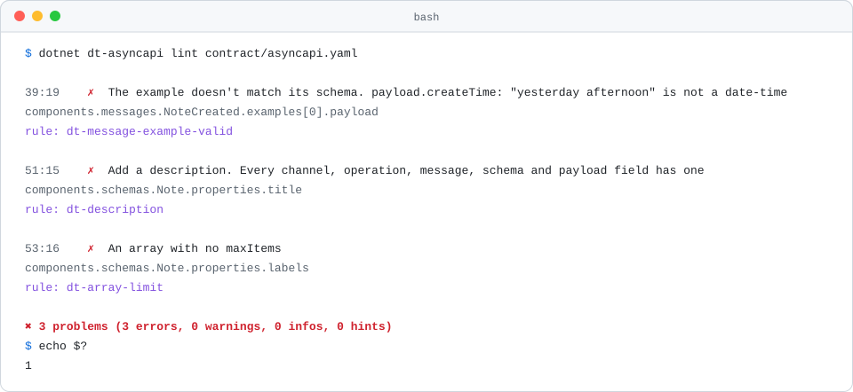
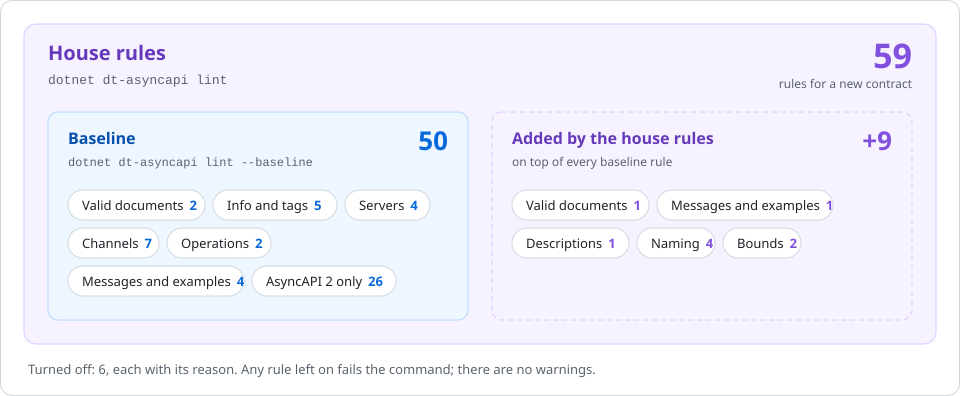

<h1 align="center">AsyncAPI rules</h1>

<p align="center">Every rule <code>dt-asyncapi lint</code> runs on an event contract, why it exists, and what fixes it.</p>

<p align="center">
  
  
  
</p>

<p align="center">
  <a href="#how-to-read-a-rule">How to read a rule</a> ·
  <a href="#the-rules">The rules</a> ·
  <a href="#turned-off">Turned off</a> ·
  <a href="#change-a-rule-for-one-repo">Change a rule</a> ·
  <a href="../../README.md">Back to the README</a>
</p>

<p align="center">
  <picture>
    <source media="(prefers-color-scheme: dark)" srcset="../images/rules-asyncapi-dark.svg">
    
  </picture>
</p>

`dt-asyncapi lint` checks an AsyncAPI 2 or 3 document, the contract of an event API, with the bundled [Spectral](https://github.com/stoplightio/spectral). Any finding fails the command with exit code 1, so a rule is either on or off: there are no warnings to ignore.

> **Tip:** every finding ends with `rule: <name>`. Search this page for the name to see why the rule exists and how to fix it.

## Two levels

<p align="center">
  <picture>
    <source media="(prefers-color-scheme: dark)" srcset="../images/rules-asyncapi-levels-dark.svg">
    
  </picture>
</p>

| Level | Use it for | How |
| --- | --- | --- |
| Baseline | An existing API. Spectral's whole `spectral:asyncapi` ruleset: a valid document, described operations and parameters, nothing defined and left unused, examples that match their schemas, and no personal data in a channel address | `dt-asyncapi lint --baseline` |
| House rules | A new contract. The baseline, plus the Digitals rules the HTTP APIs follow: descriptions, examples, camelCase naming, time and date names, and bounded strings and arrays. It also requires the newest AsyncAPI | `dt-asyncapi lint`, the default |

Spectral keeps two copies of most rules, one for AsyncAPI 2 and one for AsyncAPI 3, and runs the one that matches the document. The AsyncAPI 3 rules come first below. The AsyncAPI 2 copies are listed at the end, since only an existing API on AsyncAPI 2 meets them.

## How to read a rule

Every rule below has the same parts:

- Two badges.  runs at both levels;  runs only at the default level. The second badge says where the rule comes from: the Digitals rules, OWASP, or the bundled linter.
- Why the rule exists.
- A diff. The red lines fail the rule, the green lines pass it.
- What `dt-asyncapi` prints for the red lines, captured by running it. Where a rule can't be shown firing, a note says why.

## The rules

| Topic | Rules |
| --- | --- |
| [Valid documents](#valid-documents) | [`asyncapi-3-document-unresolved`](#asyncapi-3-document-unresolved) · [`asyncapi-3-document-resolved`](#asyncapi-3-document-resolved) · [`asyncapi-latest-version`](#asyncapi-latest-version) |
| [Info and tags](#info-and-tags) | [`asyncapi-info-description`](#asyncapi-info-description) · [`asyncapi-3-tags`](#asyncapi-3-tags) · [`asyncapi-3-tag-description`](#asyncapi-3-tag-description) · [`asyncapi-3-tags-uniqueness`](#asyncapi-3-tags-uniqueness) · [`asyncapi-3-tags-alphabetical`](#asyncapi-3-tags-alphabetical) |
| [Servers](#servers) | [`asyncapi-3-server-no-empty-variable`](#asyncapi-3-server-no-empty-variable) · [`asyncapi-3-server-no-trailing-slash`](#asyncapi-3-server-no-trailing-slash) · [`asyncapi-3-server-not-example-com`](#asyncapi-3-server-not-example-com) · [`asyncapi-unused-components-server`](#asyncapi-unused-components-server) |
| [Channels](#channels) | [`asyncapi-3-channel-no-empty-parameter`](#asyncapi-3-channel-no-empty-parameter) · [`asyncapi-3-channel-no-query-nor-fragment`](#asyncapi-3-channel-no-query-nor-fragment) · [`asyncapi-3-channel-no-trailing-slash`](#asyncapi-3-channel-no-trailing-slash) · [`asyncapi-3-channel-servers`](#asyncapi-3-channel-servers) · [`asyncapi-channel-parameters`](#asyncapi-channel-parameters) · [`asyncapi-parameter-description`](#asyncapi-parameter-description) · [`dt-no-personal-data-in-channel`](#dt-no-personal-data-in-channel) |
| [Operations](#operations) | [`asyncapi-3-operation-description`](#asyncapi-3-operation-description) · [`asyncapi-3-operation-security`](#asyncapi-3-operation-security) |
| [Messages and examples](#messages-and-examples) | [`asyncapi-3-headers-schema-type-object`](#asyncapi-3-headers-schema-type-object) · [`asyncapi-3-payload-unsupported-schemaFormat`](#asyncapi-3-payload-unsupported-schemaformat) · [`dt-message-example-valid`](#dt-message-example-valid) · [`dt-message-example`](#dt-message-example) · [`asyncapi-unused-components-schema`](#asyncapi-unused-components-schema) |
| [Descriptions](#descriptions) | [`dt-description`](#dt-description) |
| [Naming](#naming) | [`dt-property-casing`](#dt-property-casing) · [`dt-enum-casing`](#dt-enum-casing) · [`dt-timestamp-name`](#dt-timestamp-name) · [`dt-date-name`](#dt-date-name) |
| [Bounds](#bounds) | [`dt-string-limit`](#dt-string-limit) · [`dt-array-limit`](#dt-array-limit) |
| [AsyncAPI 2 only](#asyncapi-2-only) | [`asyncapi-schema`](#asyncapi-schema) · [`asyncapi-tags`](#asyncapi-tags) · [`asyncapi-tag-description`](#asyncapi-tag-description) · [`asyncapi-tags-uniqueness`](#asyncapi-tags-uniqueness) · [`asyncapi-server-no-empty-variable`](#asyncapi-server-no-empty-variable) · [`asyncapi-server-no-trailing-slash`](#asyncapi-server-no-trailing-slash) · [`asyncapi-server-not-example-com`](#asyncapi-server-not-example-com) · [`asyncapi-server-variables`](#asyncapi-server-variables) · [`asyncapi-server-security`](#asyncapi-server-security) · [`asyncapi-channel-no-empty-parameter`](#asyncapi-channel-no-empty-parameter) · [`asyncapi-channel-no-query-nor-fragment`](#asyncapi-channel-no-query-nor-fragment) · [`asyncapi-channel-no-trailing-slash`](#asyncapi-channel-no-trailing-slash) · [`asyncapi-channel-servers`](#asyncapi-channel-servers) · [`asyncapi-operation-operationId`](#asyncapi-operation-operationid) · [`asyncapi-operation-operationId-uniqueness`](#asyncapi-operation-operationid-uniqueness) · [`asyncapi-operation-description`](#asyncapi-operation-description) · [`asyncapi-operation-security`](#asyncapi-operation-security) · [`asyncapi-message-messageId-uniqueness`](#asyncapi-message-messageid-uniqueness) · [`asyncapi-message-examples`](#asyncapi-message-examples) · [`asyncapi-headers-schema-type-object`](#asyncapi-headers-schema-type-object) · [`asyncapi-payload`](#asyncapi-payload) · [`asyncapi-payload-default`](#asyncapi-payload-default) · [`asyncapi-payload-examples`](#asyncapi-payload-examples) · [`asyncapi-payload-unsupported-schemaFormat`](#asyncapi-payload-unsupported-schemaformat) · [`asyncapi-schema-default`](#asyncapi-schema-default) · [`asyncapi-schema-examples`](#asyncapi-schema-examples) |

## Valid documents

### `asyncapi-3-document-unresolved`

 

Checks the document against the AsyncAPI 3 schema as written, before any `$ref` is followed. It catches a reference where AsyncAPI doesn't allow one, which code generators and the viewer can't follow.

```diff
-info:
-  $ref: '#/x-info'
+info:
+  title: Notes events
+  version: 1.0.0
```

```text
✗ Referencing in this place is not allowed
  $.info
  rule: asyncapi-3-document-unresolved
```

### `asyncapi-3-document-resolved`

 

Checks the document against the AsyncAPI 3 schema once every `$ref` is followed: required fields, allowed values, no unknown properties. A document that fails it can't be trusted by any other tool.

```diff
 operations:
   PublishNoteCreated:
-    action: publish
+    action: send
```

```text
✗ "action" property must be equal to one of the allowed values: "send", "receive". Did you mean "receive"?
  $.operations.PublishNoteCreated.action
  rule: asyncapi-3-document-resolved
```

> **Note:** A `$ref` to something that doesn't exist is reported as `invalid-ref`, which Spectral raises itself while resolving references, outside any ruleset.

### `asyncapi-latest-version`

 

A new contract starts on the newest AsyncAPI, so it gets the newest tooling and doesn't need migrating. The baseline turns this rule off, because an existing API may stay on AsyncAPI 2.

```diff
-asyncapi: 3.0.0
+asyncapi: 3.1.0
```

```text
✗ The latest version is not used. You should update to the "3.1.0" version.
  $.asyncapi
  rule: asyncapi-latest-version
```

## Info and tags

### `asyncapi-info-description`

 

The description is the first thing a consumer reads about the API. Say what the events are and who sends them.

```diff
 info:
   title: Notes events
   version: 1.0.0
+  description: Events the notes service publishes when a note changes.
```

```text
✗ Info "description" must be present and non-empty string.
  $.info
  rule: asyncapi-info-description
```

### `asyncapi-3-tags`

 

Tags group the operations in the docs page. In AsyncAPI 3 they live under `info`.

```diff
 info:
   title: Notes events
+  tags:
+    - name: Notes
+      description: Notes, each a single line of text.
```

```text
✗ AsyncAPI document must have non-empty "tags" array.
  $.info
  rule: asyncapi-3-tags
```

### `asyncapi-3-tag-description`

 

A tag becomes a section in the docs page, and its description is that section's introduction.

```diff
   tags:
     - name: Notes
+      description: Notes, each a single line of text.
```

```text
✗ Tag object must have "description".
  $.info.tags[0]
  rule: asyncapi-3-tag-description
```

### `asyncapi-3-tags-uniqueness`

 

Two tags with one name make two sections that a reader can't tell apart.

```diff
   tags:
     - name: Notes
       description: Notes, each a single line of text.
-    - name: Notes
-      description: Notes again.
```

```text
✗ "tags" object contains duplicate tag name "Notes".
  $.info.tags[1].name
  rule: asyncapi-3-tags-uniqueness
```

### `asyncapi-3-tags-alphabetical`

 

Tags are listed in alphabetical order.

```diff
   tags:
-    - name: Reminders
-      description: Reminders the service sends.
     - name: Notes
       description: Notes, each a single line of text.
+    - name: Reminders
+      description: Reminders the service sends.
```

```text
✗ AsyncAPI object must have alphabetical "tags".
  $.info.tags
  rule: asyncapi-3-tags-alphabetical
```

> **Note:** The baseline turns off `asyncapi-tags-alphabetical`, the AsyncAPI 2 form of this rule, as not adopted, but leaves this one on. So an AsyncAPI 3 document fails on tag order and an AsyncAPI 2 document doesn't.

## Servers

### `asyncapi-3-server-no-empty-variable`

 

An empty `{}` in a host or pathname is a variable with no name, so nothing can fill it in.

```diff
 servers:
   production:
-    host: '{}.acme.com:9092'
+    host: '{cluster}.acme.com:9092'
+    variables:
+      cluster:
+        description: The cluster in this region.
```

```text
✗ Server host and pathname must not have empty variable substitution pattern.
  $.servers.production.host
  rule: asyncapi-3-server-no-empty-variable
```

### `asyncapi-3-server-no-trailing-slash`

 

A trailing slash on the host gives a different address once a client joins it to a pathname or channel.

```diff
 servers:
   production:
-    host: kafka.acme.com:9092/
+    host: kafka.acme.com:9092
```

```text
✗ Server host must not end with slash.
  $.servers.production.host
  rule: asyncapi-3-server-no-trailing-slash
```

### `asyncapi-3-server-not-example-com`

 

A server on `example.com` is a placeholder someone forgot. Name the real broker, or leave `servers` out: servers are optional.

```diff
 servers:
   production:
-    host: kafka.example.com:9092
+    host: kafka.acme.com:9092
```

```text
✗ Server host must not point at example.com.
  $.servers.production.host
  rule: asyncapi-3-server-not-example-com
```

### `asyncapi-unused-components-server`

 

A server under `components` that nothing refers to is dead text, and usually a sign a reference went to the wrong place.

```diff
 components:
-  servers:
-    spare:
-      host: kafka.acme.com:9092
-      protocol: kafka
```

```text
✗ Potentially unused components server has been detected.
  $.components.servers.spare
  rule: asyncapi-unused-components-server
```

## Channels

### `asyncapi-3-channel-no-empty-parameter`

 

An empty `{}` in an address is a parameter with no name, so no `parameters` entry can describe it.

```diff
 channels:
   noteCreated:
-    address: notes.v1.{}.created
+    address: notes.v1.created
```

```text
✗ Channel address must not have empty parameter substitution pattern.
  $.channels.noteCreated.address
  rule: asyncapi-3-channel-no-empty-parameter
```

### `asyncapi-3-channel-no-query-nor-fragment`

 

A channel address names a topic or queue. A `?` or `#` makes it look like a URL, and brokers treat it as part of the name.

```diff
 channels:
   noteCreated:
-    address: notes.v1.created?tenant=acme
+    address: notes.v1.created
```

```text
✗ Channel address must not include query ("?") or fragment ("#") delimiter.
  $.channels.noteCreated.address
  rule: asyncapi-3-channel-no-query-nor-fragment
```

### `asyncapi-3-channel-no-trailing-slash`

 

`notes/v1/created/` and `notes/v1/created` are different topics to a broker. Leave the slash off.

```diff
 channels:
   noteCreated:
-    address: notes/v1/created/
+    address: notes/v1/created
```

```text
✗ Channel address must not end with slash.
  $.channels.noteCreated.address
  rule: asyncapi-3-channel-no-trailing-slash
```

### `asyncapi-3-channel-servers`

 

A channel's `servers` refer to entries in the top-level `servers`, so a reader can see which broker carries it.

```diff
 channels:
   noteCreated:
     servers:
-      - $ref: '#/components/servers/production'
+      - $ref: '#/servers/production'
```

```text
✗ Channel servers must be defined in the "servers" object.
  $.channels.noteCreated.servers[0]['$ref']
  rule: asyncapi-3-channel-servers
```

### `asyncapi-channel-parameters`

 

Every `{parameter}` in an address has an entry in `parameters`, and every entry is in the address, so the two never drift apart.

```diff
 channels:
   noteCreated:
     address: notes.v1.{tenantId}.created
     parameters:
-      tenant:
+      tenantId:
         description: The tenant whose notes these are.
```

```text
✗ Not all channel's parameters are described with "parameters" object. Missed: tenantId.
  $.channels.noteCreated.parameters
  rule: asyncapi-channel-parameters
```

> **Note:** It reports both sides: the parameter missing from `parameters`, and the entry that isn't in the address.

### `asyncapi-parameter-description`

 

A parameter's description says what fills that part of the address, which the name alone rarely does.

```diff
 channels:
   noteCreated:
     address: notes.v1.{tenantId}.created
     parameters:
-      tenantId: {}
+      tenantId:
+        description: The tenant whose notes these are.
```

```text
✗ Parameter objects must have "description".
  $.channels.noteCreated.parameters.tenantId
  rule: asyncapi-parameter-description
```

### `dt-no-personal-data-in-channel`

 

A channel address ends up in broker logs, metrics and dashboards, so a parameter never carries personal data: a name, email address, phone number, postal address or postcode, date of birth, or national ID number. Send it in the payload.

```diff
 channels:
   noteCreated:
-    address: notes.v1.{email}.created
-    parameters:
-      email:
-        description: Whose notes these are.
+    address: notes.v1.created
```

```text
✗ Channel parameter 'email' puts personal data in the address: send it in the payload
  $.channels.noteCreated.parameters.email
  rule: dt-no-personal-data-in-channel
```

## Operations

### `asyncapi-3-operation-description`

 

The summary names the operation; the description says when it happens and what a consumer can rely on.

```diff
 operations:
   PublishNoteCreated:
     action: send
     summary: Publishes each new note.
+    description: Sends a NoteCreated message once the note is stored.
```

```text
✗ Operation "description" must be present and non-empty string.
  $.operations.PublishNoteCreated
  rule: asyncapi-3-operation-description
```

> **Note:** At the default level `dt-description` reports the same operation too.

### `asyncapi-3-operation-security`

 

An operation's `security` refers to a scheme defined under `components.securitySchemes`. The AsyncAPI 2 form, a scheme name mapped to scopes, refers to nothing in AsyncAPI 3.

```diff
 operations:
   PublishNoteCreated:
     action: send
     security:
-      - bearer: []
+      - $ref: '#/components/securitySchemes/bearer'
```

```text
✗ Operation must not reference an undefined security scheme.
  $.operations.PublishNoteCreated.security[0].bearer
  rule: asyncapi-3-operation-security
```

> **Note:** `asyncapi-3-document-resolved` reports the same entry, since the AsyncAPI 2 form isn't valid AsyncAPI 3.

## Messages and examples

### `asyncapi-3-headers-schema-type-object`

 

Message headers are named values, so their schema is an object with one property per header.

```diff
 NoteCreated:
   headers:
-    type: string
-    maxLength: 10
+    type: object
+    properties:
+      correlationId: { type: string, format: uuid, maxLength: 36 }
```

```text
✗ Headers schema type must be "object" ("type" property must be equal to one of the allowed values: "object". Did you mean "object"?).
  $.components.messages.NoteCreated.headers.type
  rule: asyncapi-3-headers-schema-type-object
```

### `asyncapi-3-payload-unsupported-schemaFormat`

 

Spectral can only check a payload written as an AsyncAPI or JSON schema. With Avro or another `schemaFormat`, no rule can check the payload or its examples, so the contract goes unchecked.

```diff
 NoteCreated:
   payload:
-    schemaFormat: application/vnd.apache.avro;version=1.9.0
-    schema:
-      $ref: '#/components/schemas/NoteAvro'
+    $ref: '#/components/schemas/Note'
```

```text
✗ Message schema validation is only supported with default unspecified "schemaFormat".
  $.components.messages.NoteCreated.payload.schemaFormat
  rule: asyncapi-3-payload-unsupported-schemaFormat
```

> **Note:** This edit also fails `asyncapi-3-document-resolved`, because the JSON schema it points at isn't Avro.

### `dt-message-example-valid`

 

An example that doesn't match its schema teaches consumers the wrong shape. Every message example's payload and headers are checked against the message's schemas: type, enum, const, required fields, lengths, patterns, ranges, item counts and the common formats. Spectral's `asyncapi-message-examples` does this for AsyncAPI 2 only.

```diff
 examples:
   - name: officeSupplies
     payload:
       noteId: 3f2a9c1e-7b4d-4e0a-8c5f-6d1b2a9e0c73
-      status: deleted
+      status: active
```

```text
✗ The example doesn't match its schema. payload.status: "deleted" is not one of ["active","archived"]
  $.components.messages.NoteCreated.examples[0].payload
  rule: dt-message-example-valid
```

> **Note:** The rule is JavaScript in `functions/messageExampleValid.js`. `dt-asyncapi ruleset <path>` writes it beside the rulesets.

### `dt-message-example`

 

A consumer learns a message from its example faster than from its schema, and an example is what `dt-message-example-valid` checks the schema against.

```diff
 NoteCreated:
   payload:
     $ref: '#/components/schemas/Note'
+  examples:
+    - name: officeSupplies
+      payload:
+        noteId: 3f2a9c1e-7b4d-4e0a-8c5f-6d1b2a9e0c73
```

```text
✗ Add an example to the message's examples
  $.components.messages.NoteCreated
  rule: dt-message-example
```

### `asyncapi-unused-components-schema`

 

A schema nothing refers to is dead text that still has to be kept true. Delete it, or refer to it.

```diff
 components:
   schemas:
-    Unused:
-      type: object
-      description: Nothing refers to it.
     Note:
```

```text
✗ Potentially unused components schema has been detected.
  $.components.schemas.Unused
  rule: asyncapi-unused-components-schema
```

## Descriptions

### `dt-description`

 

The contract is the documentation, so every channel, operation, message, component schema and payload field says what it is. The same rule covers the HTTP APIs.

```diff
 properties:
-  title: { type: string, maxLength: 200 }
+  title:
+    type: string
+    maxLength: 200
+    description: The note's text, on one line.
```

```text
✗ Add a description. Every channel, operation, message, schema and payload field has one
  $.components.schemas.Note.properties.title
  rule: dt-description
```

## Naming

### `dt-property-casing`

 

Payload fields are camelCase, as in the HTTP APIs, so one client model serves both.

```diff
 properties:
-  note_id:
+  noteId:
     type: string
     format: uuid
```

```text
✗ 'note_id' is not camelCase
  $.components.schemas.Note.properties.note_id
  rule: dt-property-casing
```

### `dt-enum-casing`

 

Enum values are camelCase strings, as in the HTTP APIs. Binding enums, such as a Kafka `clientId`, keep the broker's own naming.

```diff
 status:
   type: string
-  enum: [active, ON_HOLD]
+  enum: [active, onHold]
```

```text
✗ 'ON_HOLD' is not camelCase
  $.components.schemas.Note.properties.status.enum[1]
  rule: dt-enum-casing
```

### `dt-timestamp-name`

 

A timestamp's name ends in `Time`, so a reader knows it's a point in time without opening the schema.

```diff
 properties:
-  created:
+  createTime:
     type: string
     format: date-time
```

```text
✗ 'created' is a date-time, so its name ends in Time, like createTime
  $.components.schemas.Note.properties.created
  rule: dt-timestamp-name
```

### `dt-date-name`

 

A calendar date's name ends in `Date`, so it isn't mistaken for a timestamp with a time zone.

```diff
 properties:
-  dueTime:
+  dueDate:
     type: string
     format: date
```

```text
✗ 'dueTime' is a date, so its name ends in Date, like birthDate
  $.components.schemas.Note.properties.dueTime
  rule: dt-date-name
```

## Bounds

### `dt-string-limit`

 

A consumer sizes its storage from the contract. Every string says how long it can be, with `maxLength`, an `enum` or a `const`.

```diff
 title:
   type: string
+  maxLength: 200
```

```text
✗ A string with no maxLength, enum or const
  $.components.schemas.Note.properties.title
  rule: dt-string-limit
```

### `dt-array-limit`

 

An unbounded array is an unbounded message. Every array says how many items it can hold.

```diff
 tags:
   type: array
+  maxItems: 10
   items: { type: string, maxLength: 20 }
```

```text
✗ An array with no maxItems
  $.components.schemas.Note.properties.tags
  rule: dt-array-limit
```

## AsyncAPI 2 only

### `asyncapi-schema`

 

Checks the document against the AsyncAPI 2 schema: required fields, allowed values, no unknown properties.

```diff
 info:
   title: Notes events
+  version: 1.0.0
```

```text
✗ "info" property must have required property "version"
  $.info
  rule: asyncapi-schema
```

### `asyncapi-tags`

 

The AsyncAPI 2 form of [`asyncapi-3-tags`](#asyncapi-3-tags). In AsyncAPI 2 the tags are at the top level.

```diff
+tags:
+  - name: Notes
+    description: Notes, each a single line of text.
```

```text
✗ AsyncAPI object must have non-empty "tags" array.
  $
  rule: asyncapi-tags
```

### `asyncapi-tag-description`

 

The AsyncAPI 2 form of [`asyncapi-3-tag-description`](#asyncapi-3-tag-description).

```diff
 tags:
   - name: Notes
+    description: Notes, each a single line of text.
```

```text
✗ Tag object must have "description".
  $.tags[0]
  rule: asyncapi-tag-description
```

### `asyncapi-tags-uniqueness`

 

The AsyncAPI 2 form of [`asyncapi-3-tags-uniqueness`](#asyncapi-3-tags-uniqueness).

```diff
 tags:
   - name: Notes
     description: Notes, each a single line of text.
-  - name: Notes
-    description: Notes again.
```

```text
✗ "tags" object contains duplicate tag name "Notes".
  $.tags[1].name
  rule: asyncapi-tags-uniqueness
```

### `asyncapi-server-no-empty-variable`

 

The AsyncAPI 2 form of [`asyncapi-3-server-no-empty-variable`](#asyncapi-3-server-no-empty-variable).

```diff
 servers:
   production:
-    url: '{}.kafka.acme.com:9092'
+    url: kafka.acme.com:9092
```

```text
✗ Server URL must not have empty variable substitution pattern.
  $.servers.production.url
  rule: asyncapi-server-no-empty-variable
```

### `asyncapi-server-no-trailing-slash`

 

The AsyncAPI 2 form of [`asyncapi-3-server-no-trailing-slash`](#asyncapi-3-server-no-trailing-slash).

```diff
 servers:
   production:
-    url: kafka.acme.com:9092/
+    url: kafka.acme.com:9092
```

```text
✗ Server URL must not end with slash.
  $.servers.production.url
  rule: asyncapi-server-no-trailing-slash
```

### `asyncapi-server-not-example-com`

 

The AsyncAPI 2 form of [`asyncapi-3-server-not-example-com`](#asyncapi-3-server-not-example-com).

```diff
 servers:
   production:
-    url: kafka.example.com:9092
+    url: kafka.acme.com:9092
```

```text
✗ Server URL must not point at example.com.
  $.servers.production.url
  rule: asyncapi-server-not-example-com
```

### `asyncapi-server-variables`

 

Every `{variable}` in a server URL has an entry in `variables`, and every entry is in the URL.

```diff
 servers:
   production:
     url: '{region}.kafka.acme.com:9092'
+    variables:
+      region:
+        default: london
```

```text
✗ Not all server's variables are described with "variables" object. Missed: region.
  $.servers.production
  rule: asyncapi-server-variables
```

### `asyncapi-server-security`

 

A server's `security` names a scheme defined under `components.securitySchemes`.

```diff
 servers:
   production:
     security:
-      - oauth: []
+      - bearer: []
```

```text
✗ Server must not reference an undefined security scheme.
  $.servers.production.security[0].oauth
  rule: asyncapi-server-security
```

> **Note:** The passing form needs `bearer` defined under `components.securitySchemes`.

### `asyncapi-channel-no-empty-parameter`

 

The AsyncAPI 2 form of [`asyncapi-3-channel-no-empty-parameter`](#asyncapi-3-channel-no-empty-parameter).

```diff
 channels:
-  notes.v1.{}.created:
+  notes.v1.created:
```

```text
✗ Channel path must not have empty parameter substitution pattern.
  $.channels['notes.v1.{}.created']
  rule: asyncapi-channel-no-empty-parameter
```

> **Note:** `asyncapi-schema` reports the same channel, since `{}` isn't a valid URI template.

### `asyncapi-channel-no-query-nor-fragment`

 

The AsyncAPI 2 form of [`asyncapi-3-channel-no-query-nor-fragment`](#asyncapi-3-channel-no-query-nor-fragment).

```diff
 channels:
-  notes.v1.created?tenant=acme:
+  notes.v1.created:
```

```text
✗ Channel path must not include query ("?") or fragment ("#") delimiter.
  $.channels['notes.v1.created?tenant=acme']
  rule: asyncapi-channel-no-query-nor-fragment
```

### `asyncapi-channel-no-trailing-slash`

 

The AsyncAPI 2 form of [`asyncapi-3-channel-no-trailing-slash`](#asyncapi-3-channel-no-trailing-slash).

```diff
 channels:
-  notes/v1/created/:
+  notes/v1/created:
```

```text
✗ Channel path must not end with slash.
  $.channels['notes/v1/created/']
  rule: asyncapi-channel-no-trailing-slash
```

### `asyncapi-channel-servers`

 

The AsyncAPI 2 form of [`asyncapi-3-channel-servers`](#asyncapi-3-channel-servers). In AsyncAPI 2 a channel lists server names.

```diff
 channels:
   notes.v1.created:
-    servers: [staging]
+    servers: [production]
```

```text
✗ Channel contains server that are not defined on the "servers" object.
  $.channels['notes.v1.created'].servers[0]
  rule: asyncapi-channel-servers
```

### `asyncapi-operation-operationId`

 

An `operationId` names the operation in generated code and in the docs page. AsyncAPI 3 makes the operation's key its id.

```diff
 subscribe:
+  operationId: PublishNoteCreated
   summary: Publishes each new note.
```

```text
✗ Operation must have "operationId".
  $.channels['notes.v1.created'].subscribe
  rule: asyncapi-operation-operationId
```

### `asyncapi-operation-operationId-uniqueness`

 

Two operations with one id generate two methods with one name.

```diff
 notes.v1.archived:
   subscribe:
-    operationId: PublishNoteCreated
+    operationId: PublishNoteArchived
```

```text
✗ "operationId" must be unique across all the operations.
  $.channels['notes.v1.created'].subscribe.operationId
  rule: asyncapi-operation-operationId-uniqueness
```

> **Note:** `asyncapi-message-messageId-uniqueness` fires on this edit too, because both channels send the same message.

### `asyncapi-operation-description`

 

The AsyncAPI 2 form of [`asyncapi-3-operation-description`](#asyncapi-3-operation-description).

```diff
 subscribe:
   operationId: PublishNoteCreated
   summary: Publishes each new note.
+  description: Sends a NoteCreated message once the note is stored.
```

```text
✗ Operation "description" must be present and non-empty string.
  $.channels['notes.v1.created'].subscribe
  rule: asyncapi-operation-description
```

### `asyncapi-operation-security`

 

The AsyncAPI 2 form of [`asyncapi-3-operation-security`](#asyncapi-3-operation-security). In AsyncAPI 2 it names the scheme.

```diff
 subscribe:
   security:
-    - oauth: [notes.read]
+    - bearer: []
```

```text
✗ Operation must not reference an undefined security scheme.
  $.channels['notes.v1.created'].subscribe.security[0].oauth
  rule: asyncapi-operation-security
```

> **Note:** The passing form needs `bearer` defined under `components.securitySchemes`.

### `asyncapi-message-messageId-uniqueness`

 

Two messages with one `messageId` can't be told apart by a consumer that routes on it.

```diff
 NoteCopied:
-  messageId: NoteCreated
+  messageId: NoteCopied
```

```text
✗ "messageId" must be unique across all the messages.
  $.components.messages.NoteCopied.messageId
  rule: asyncapi-message-messageId-uniqueness
```

### `asyncapi-message-examples`

 

Every message example matches the message's payload and headers schemas. [`dt-message-example-valid`](#dt-message-example-valid) does this for AsyncAPI 3.

```diff
 examples:
   - name: officeSupplies
     payload:
-      status: deleted
+      status: active
```

```text
✗ "status" property must be equal to one of the allowed values: "active", "archived"
  $.components.messages.NoteCreated.examples[0].payload.status
  rule: asyncapi-message-examples
```

### `asyncapi-headers-schema-type-object`

 

The AsyncAPI 2 form of [`asyncapi-3-headers-schema-type-object`](#asyncapi-3-headers-schema-type-object).

```diff
 NoteCreated:
   headers:
-    type: array
-    items: { type: string, maxLength: 10 }
+    type: object
+    properties:
+      correlationId: { type: string, format: uuid, maxLength: 36 }
```

```text
✗ Headers schema type must be "object" ("type" property must be equal to one of the allowed values: "object". Did you mean "object"?).
  $.components.messages.NoteCreated.headers.type
  rule: asyncapi-headers-schema-type-object
```

> **Note:** `asyncapi-schema` reports the same headers, since the AsyncAPI 2 schema also requires an object.

### `asyncapi-payload`

 

A payload is a valid AsyncAPI schema object.

```diff
 Note:
   type: object
-  minProperties: -1
+  minProperties: 1
```

```text
✗ "minProperties" property must be >= 0
  $.components.schemas.Note.minProperties
  rule: asyncapi-payload
```

> **Note:** `asyncapi-schema` reports the same schema, and `asyncapi-message-examples` reports that it can't check the example against it.

### `asyncapi-payload-default`

 

A payload's `default` is valid against the payload's own schema.

```diff
 Note:
   type: object
-  default: []
+  default: {}
```

```text
✗ "default" property type must be object
  $.components.schemas.Note.default
  rule: asyncapi-payload-default
```

> **Note:** `asyncapi-schema-default` reports the same value, because `Note` is both a component schema and the payload.

### `asyncapi-payload-examples`

 

A payload's `examples` are valid against the payload's own schema.

```diff
 Note:
   type: object
-  examples: [{ noteId: 7 }]
+  examples: [{ noteId: 3f2a9c1e-7b4d-4e0a-8c5f-6d1b2a9e0c73, title: Order more paper., status: active }]
```

```text
✗ "0" property must have required property "title"
  $.components.schemas.Note.examples[0]
  rule: asyncapi-payload-examples
```

> **Note:** `asyncapi-schema-examples` reports the same examples, because `Note` is both a component schema and the payload.

### `asyncapi-payload-unsupported-schemaFormat`

 

The AsyncAPI 2 form of [`asyncapi-3-payload-unsupported-schemaFormat`](#asyncapi-3-payload-unsupported-schemaformat).

```diff
 NoteCreated:
   contentType: application/json
-  schemaFormat: application/vnd.apache.avro;version=1.9.0
-  payload:
-    type: record
+  payload:
+    $ref: '#/components/schemas/Note'
```

```text
✗ Message schema validation is only supported with default unspecified "schemaFormat".
  $.components.messages.NoteCreated.schemaFormat
  rule: asyncapi-payload-unsupported-schemaFormat
```

> **Note:** This edit also leaves `Note` unused, so `asyncapi-unused-components-schema` fires too.

### `asyncapi-schema-default`

 

A component schema's `default` is valid against the schema.

```diff
 Note:
   type: object
-  default: []
+  default: {}
```

```text
✗ "default" property type must be object
  $.components.schemas.Note.default
  rule: asyncapi-schema-default
```

> **Note:** `asyncapi-payload-default` reports the same value when the schema is a payload.

### `asyncapi-schema-examples`

 

A component schema's `examples` are valid against the schema.

```diff
 Note:
   type: object
-  examples: [{ noteId: 7 }]
+  examples: [{ noteId: 3f2a9c1e-7b4d-4e0a-8c5f-6d1b2a9e0c73, title: Order more paper., status: active }]
```

```text
✗ "0" property must have required property "title"
  $.components.schemas.Note.examples[0]
  rule: asyncapi-schema-examples
```

> **Note:** `asyncapi-payload-examples` reports the same examples when the schema is a payload.

## Turned off

The baseline turns these `spectral:asyncapi` rules off. It also turns off `asyncapi-latest-version`, which the house rules turn back on.

| Rule | Why it is off |
| --- | --- |
| `asyncapi-info-contact` | Contact is optional, decided 2026-10-29. |
| `asyncapi-info-contact-properties` | Contact is optional, decided 2026-10-29. |
| `asyncapi-info-license` | License is optional, decided 2026-10-29. |
| `asyncapi-info-license-url` | License is optional, decided 2026-10-29. |
| `asyncapi-servers` | Servers are optional, decided 2026-10-29. |
| `asyncapi-tags-alphabetical` | Not adopted, as for the HTTP APIs. Its AsyncAPI 3 form, [`asyncapi-3-tags-alphabetical`](#asyncapi-3-tags-alphabetical), is still on. |

## Not checked yet

- **Event conventions.** Channel naming, the message envelope and event versioning aren't decided yet, so no rule checks them.
- **Breaking changes.** There's no `breaking` command for AsyncAPI: no AsyncAPI diff tool ships as a standalone binary. `dt-openapi breaking` and `dt-protobuf breaking` cover the other two formats.

## Change a rule for one repo

Write the rulesets next to your contract, extend them, and pass yours back with `--ruleset`:

```bash
dotnet dt-asyncapi ruleset contract/digitals.yaml   # writes digitals.yaml, digitals-baseline.yaml and functions/
```

```yaml
# contract/asyncapi-rules.yaml
extends:
  - ./digitals.yaml
rules:
  asyncapi-3-tags-alphabetical: off   # say why
```

```bash
dotnet dt-asyncapi lint contract/asyncapi.yaml --ruleset contract/asyncapi-rules.yaml
```

Keep `functions/` beside the rulesets: `dt-message-example-valid` runs the JavaScript in it. The same files work with the Spectral editor extensions, so the editor underlines what `lint` will report.
