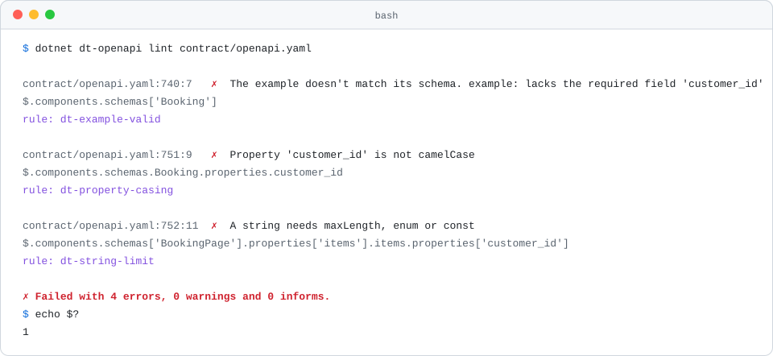
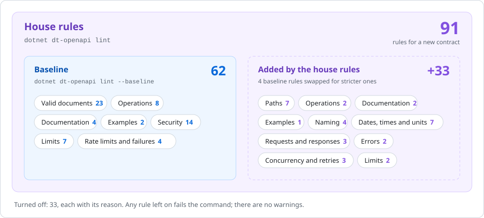

<h1 align="center">OpenAPI rules</h1>

<p align="center">Every rule <code>dt-openapi lint</code> runs, why it exists, and how to fix a finding.</p>

<p align="center">
  
  
  
</p>

<p align="center">
  <a href="#how-to-read-a-rule">How to read a rule</a> ·
  <a href="#the-rules">The rules</a> ·
  <a href="#turned-off">Turned off</a> ·
  <a href="#change-a-rule-for-one-repo">Change a rule</a> ·
  <a href="../../README.md">Back to the README</a>
</p>

<p align="center">
  <picture>
    <source media="(prefers-color-scheme: dark)" srcset="../images/lint-dark.svg">
    
  </picture>
</p>

`dt-openapi lint` checks an OpenAPI 3.0 or 3.1 contract with [vacuum](https://github.com/daveshanley/vacuum) and the Digitals rules. This page lists every rule it runs, why it exists, the change that fixes it, and the message you get when it fails.

> **Tip:** every finding ends with `rule: <id>`. Search this page for the id to see why the rule exists and how to fix it.

Every example edits one small contract that passes every rule: a projects API with one `POST .../{projectId}:archive` operation. [examples/openapi.yaml](../../examples/openapi.yaml) is a full API that passes every rule too, and the best place to copy from.

## Two levels

<p align="center">
  <picture>
    <source media="(prefers-color-scheme: dark)" srcset="../images/rules-openapi-levels-dark.svg">
    
  </picture>
</p>

| Level | Ruleset | Use it for |
| --- | --- | --- |
| Baseline | `digitals-baseline.yaml`, with `--baseline` | Auditing an existing API that was never built to our conventions |
| House rules | `digitals.yaml`, the default | Every new contract |

Both list every vacuum built-in, set to `error` or turned `off` with the reason, so a rule that is on fails `lint`. There are no warnings.

## How to read a rule

Every rule below has the same parts:

- Two badges.  runs at both levels;  runs only at the default level.  runs only with `--baseline`, because the default level replaces it with a stricter rule. The second badge says where the rule comes from: the Digitals rules, OWASP, or the bundled linter.
- Why the rule exists.
- A diff. The red lines fail the rule, the green lines pass it.
- What `dt-openapi` prints for the red lines, captured by running it. Where a rule can't be shown firing, a note says why.

## The rules

| Topic | Rules |
| --- | --- |
| [Valid documents](#valid-documents) | [`oas3-schema`](#oas3-schema) · [`oas-schema-check`](#oas-schema-check) · [`allof-conflicts`](#allof-conflicts) · [`duplicate-paths`](#duplicate-paths) · [`duplicated-entry-in-enum`](#duplicated-entry-in-enum) · [`typed-enum`](#typed-enum) · [`nullable-enum-contains-null`](#nullable-enum-contains-null) · [`no-$ref-siblings`](#no-ref-siblings) · [`oas3-no-$ref-siblings`](#oas3-no-ref-siblings) · [`no-ambiguous-paths`](#no-ambiguous-paths) · [`path-declarations-must-exist`](#path-declarations-must-exist) · [`path-not-include-query`](#path-not-include-query) · [`path-keys-no-trailing-slash`](#path-keys-no-trailing-slash) · [`paths-specificity-order`](#paths-specificity-order) · [`path-params`](#path-params) · [`operation-parameters`](#operation-parameters) · [`required-fields-defined`](#required-fields-defined) · [`oas3-unused-component`](#oas3-unused-component) · [`oas3-example-external-check`](#oas3-example-external-check) · [`no-eval-in-markdown`](#no-eval-in-markdown) · [`no-script-tags-in-markdown`](#no-script-tags-in-markdown) · [`info-license-spdx`](#info-license-spdx) · [`oas3-operation-security-defined`](#oas3-operation-security-defined) |
| [Paths](#paths) | [`dt-path-version`](#dt-path-version) · [`dt-path-segments`](#dt-path-segments) · [`dt-path-word-count`](#dt-path-word-count) · [`dt-path-id`](#dt-path-id) · [`dt-path-depth`](#dt-path-depth) · [`dt-no-http-verb-action`](#dt-no-http-verb-action) · [`no-http-verbs-in-path`](#no-http-verbs-in-path) |
| [Operations](#operations) | [`operation-operationId`](#operation-operationid) · [`operation-operationId-unique`](#operation-operationid-unique) · [`dt-operation-id-casing`](#dt-operation-id-casing) · [`operation-operationId-valid-in-url`](#operation-operationid-valid-in-url) · [`operation-tags`](#operation-tags) · [`operation-tag-defined`](#operation-tag-defined) · [`openapi-tags`](#openapi-tags) · [`operation-singular-tag`](#operation-singular-tag) · [`operation-success-response`](#operation-success-response) · [`post-response-success`](#post-response-success) |
| [Documentation](#documentation) | [`dt-operation-summary`](#dt-operation-summary) · [`operation-description`](#operation-description) · [`dt-description`](#dt-description) · [`oas3-parameter-description`](#oas3-parameter-description) · [`info-description`](#info-description) · [`tag-description`](#tag-description) |
| [Examples](#examples) | [`dt-example`](#dt-example) · [`dt-example-valid`](#dt-example-valid) · [`oas3-valid-schema-example`](#oas3-valid-schema-example) |
| [Naming](#naming) | [`dt-property-casing`](#dt-property-casing) · [`dt-parameter-casing`](#dt-parameter-casing) · [`dt-enum-casing`](#dt-enum-casing) · [`dt-no-integer-enum`](#dt-no-integer-enum) |
| [Dates, times and units](#dates-times-and-units) | [`dt-timestamp-name`](#dt-timestamp-name) · [`dt-date-name`](#dt-date-name) · [`dt-time-suffix-format`](#dt-time-suffix-format) · [`dt-date-suffix-format`](#dt-date-suffix-format) · [`dt-unit-integer`](#dt-unit-integer) · [`dt-unit-name`](#dt-unit-name) · [`dt-no-duration-string`](#dt-no-duration-string) |
| [Requests and responses](#requests-and-responses) | [`dt-request-media-type`](#dt-request-media-type) · [`dt-paging-in-query`](#dt-paging-in-query) · [`dt-no-bare-array-response`](#dt-no-bare-array-response) |
| [Errors](#errors) | [`dt-problem-json`](#dt-problem-json) · [`dt-error-example`](#dt-error-example) |
| [Concurrency and retries](#concurrency-and-retries) | [`dt-conditional-write`](#dt-conditional-write) · [`dt-etag-response`](#dt-etag-response) · [`dt-idempotent-create`](#dt-idempotent-create) |
| [Security](#security) | [`owasp-protection-global-unsafe`](#owasp-protection-global-unsafe) · [`owasp-protection-global-unsafe-strict`](#owasp-protection-global-unsafe-strict) · [`owasp-protection-global-safe`](#owasp-protection-global-safe) · [`owasp-define-error-responses-401`](#owasp-define-error-responses-401) · [`owasp-no-http-basic`](#owasp-no-http-basic) · [`owasp-auth-insecure-schemes`](#owasp-auth-insecure-schemes) · [`owasp-auth-urls-https`](#owasp-auth-urls-https) · [`owasp-oauth-no-implicit`](#owasp-oauth-no-implicit) · [`owasp-oauth-no-password`](#owasp-oauth-no-password) · [`owasp-security-hosts-https-oas3`](#owasp-security-hosts-https-oas3) · [`owasp-no-api-keys-in-url`](#owasp-no-api-keys-in-url) · [`owasp-no-credentials-in-url`](#owasp-no-credentials-in-url) · [`owasp-no-numeric-ids`](#owasp-no-numeric-ids) · [`dt-no-personal-data-in-url`](#dt-no-personal-data-in-url) |
| [Limits](#limits) | [`dt-string-limit`](#dt-string-limit) · [`owasp-string-limit`](#owasp-string-limit) · [`dt-array-limit`](#dt-array-limit) · [`owasp-array-limit`](#owasp-array-limit) · [`owasp-string-restricted`](#owasp-string-restricted) · [`owasp-integer-limit`](#owasp-integer-limit) · [`owasp-integer-format`](#owasp-integer-format) · [`owasp-no-additionalProperties`](#owasp-no-additionalproperties) · [`owasp-constrained-additionalProperties`](#owasp-constrained-additionalproperties) |
| [Rate limits and failures](#rate-limits-and-failures) | [`owasp-rate-limit`](#owasp-rate-limit) · [`owasp-define-error-responses-429`](#owasp-define-error-responses-429) · [`owasp-rate-limit-retry-after`](#owasp-rate-limit-retry-after) · [`owasp-define-error-responses-500`](#owasp-define-error-responses-500) |

## Valid documents

### `oas3-schema`

 

The document must be valid OpenAPI 3. A contract that breaks the spec breaks the code generators, mock servers and viewers that read it, usually in confusing ways.

```diff
 info:
   title: Projects
+  version: v1
   description: Projects for teams.
```

```text
✗ schema invalid: `/info` missing properties: `[version]`
  $.info
  rule: oas3-schema
```

### `oas-schema-check`

 

Every schema must be valid JSON Schema. A negative `maxLength` or a misspelt type passes YAML parsing and then fails in the validator that runs in production.

```diff
 reason:
   type: string
-  maxLength: -1
+  maxLength: 500
```

```text
✗ `maxLength` should be a non-negative number
  $.components.schemas.Archive.properties.reason.maxLength
  rule: oas-schema-check
```

> **Note:** The example no longer fits the schema either, so `dt-example-valid` fires beside it.

### `allof-conflicts`

 

The schemas in an `allOf` must agree. A property that is a string in one part and an integer in another can never hold a value, so no request can pass.

```diff
 Code:
   allOf:
     - properties:
         kind: { type: string, maxLength: 9 }
     - properties:
-        kind: { type: integer }
+        kind: { type: string, maxLength: 9 }
```

```text
✗ `allOf` property `kind` declared as [string, integer]: properties defined across an `allOf` composition must have a non-empty common valid type
  $.components.schemas.Code.allOf
  rule: allof-conflicts
```

> **Note:** No example can match a schema like this, so the two example rules fire beside it.

### `duplicate-paths`

 

A path is listed once. YAML keeps only the last of two equal keys, so the first operation would disappear without a word.

```diff
 paths:
   /api/v1/projects/{projectId}:archive:
     post: ...
-  /api/v1/projects/{projectId}:archive:
-    get: ...
```

> **Note:** vacuum 0.33 refuses to parse a document with a repeated path key, so `lint` stops with `Failed to parse specification` before this rule runs. Either way the document fails.

### `duplicated-entry-in-enum`

 

An enum lists each value once. A repeat is a copy-paste slip, and some generators refuse it.

```diff
 Status:
   type: string
-  enum: [active, archived, active]
+  enum: [active, archived]
```

```text
✗ enum contains a duplicate: `active`
  $.components.schemas.Status.enum
  rule: duplicated-entry-in-enum
```

### `typed-enum`

 

Every enum value has the schema's type. A number in a string enum can't be sent.

```diff
 Status:
   type: string
-  enum: [active, archived, 3]
+  enum: [active, archived]
```

```text
✗ enum type mismatch: enum value '3' is a integer, but it's defined as a 'string'
  rule: typed-enum
```

> **Note:** `oas-schema-check` reports the same value, and `dt-enum-casing` reports that `3` is not camelCase.

### `nullable-enum-contains-null`

 

A nullable enum lists `null` among its values. Without it, a validator rejects the `null` the type allows.

```diff
 Status:
   type: [ 'null', string ]
-  enum: [active, archived]
+  enum: [active, archived, null]
```

```text
✗ enum is defined as nullable but does not contain a `null` value. Nullable enums must explicitly include `null` in the enum array (not the string "null")
  $.components.schemas.Status
  rule: nullable-enum-contains-null
```

### `no-$ref-siblings`

 

In OpenAPI 3.0 a `$ref` replaces the whole object, so any key beside it is ignored. Put the description on the component instead, or move to 3.1, which allows `description` and `summary` beside a `$ref`.

```diff
 # openapi: 3.0.3
 status:
   $ref: '#/components/schemas/Status'
-  description: Where the project is in its lifecycle.
```

```text
✗ a `$ref` cannot be placed next to any other properties
  $.components.schemas.Status
  rule: no-$ref-siblings
```

### `oas3-no-$ref-siblings`

 

The OpenAPI 3.1 twin of `no-$ref-siblings`. It stays on in case a vacuum release makes it fire.

```diff
 status:
   $ref: '#/components/schemas/Status'
   description: Where the project is in its lifecycle.   # allowed in 3.1
```

> **Note:** vacuum 0.33 never reports this rule, even with keys other than `description` and `summary` beside a `$ref`.

### `no-ambiguous-paths`

 

Two templated paths that match the same URLs leave the router to pick one. Use one parameter name for one resource.

```diff
 paths:
   /api/v1/projects/{projectId}:
     get: ...
-  /api/v1/projects/{planId}:
-    get: ...
```

```text
✗ paths are ambiguous with one another: `/api/v1/projects/{planId}` (GET) and `/api/v1/projects/{projectId}` (GET)
  $.paths['/api/v1/projects/{projectId}']
  rule: no-ambiguous-paths
```

> **Note:** `path-params` fires too, since the two paths name the same parameter differently.

### `path-declarations-must-exist`

 

A path parameter has a name. `{}` matches nothing a parameter can describe.

```diff
-/api/v1/projects/{}:
+/api/v1/projects/{projectId}:
```

```text
✗ Path parameter declarations must not be empty ex. `/api/{}` is invalid: matches the expression `{}`
  $.paths
  rule: path-declarations-must-exist
```

> **Note:** An empty name breaks several other rules at once.

### `path-not-include-query`

 

A path has no query string. Query parameters are declared as parameters with `in: query`, so clients and validators see them.

```diff
-/api/v1/projects?status=active:
+/api/v1/projects:
+  get:
+    parameters:
+      - { name: status, in: query, ... }
```

```text
✗ Path must not include query string: matches the expression `\?`
  $.paths
  rule: path-not-include-query
```

### `path-keys-no-trailing-slash`

 

A path has no trailing slash. `/projects/` and `/projects` are different URLs to many routers and caches.

```diff
-/api/v1/projects/:
+/api/v1/projects:
```

```text
✗ Path must not end with a slash: matches the expression `.+\/$`
  $.paths
  rule: path-keys-no-trailing-slash
```

### `paths-specificity-order`

 

A fixed path comes before a templated path that could also match it. Some routers and mock servers take the first match, so `/projects/archived` would be read as a project with the id `archived`.

```diff
 paths:
+  /api/v1/projects/archived:
+    get: ...
   /api/v1/projects/{projectId}:
     get: ...
-  /api/v1/projects/archived:
-    get: ...
```

```text
✗ path `/api/v1/projects/archived` should be declared before `/api/v1/projects/{projectId}` for method(s) GET because a static segment at the first differing position is more specific than a templated segment
  $.paths['/api/v1/projects/archived']
  rule: paths-specificity-order
```

### `path-params`

 

Every `{parameter}` in a path is declared, and every declared path parameter is in the path.

```diff
 /api/v1/projects/{projectId}:archive:
   post:
     parameters:
-      - name: planId
+      - name: projectId
         in: path
```

```text
✗ parameter named `projectId` must be defined as part of the path `/api/v1/projects/{projectId}:archive` definition, or in the `POST` operation(s)
  $.paths['/api/v1/projects/{projectId}:archive']
  rule: path-params
```

### `operation-parameters`

 

An operation declares each parameter once. Two with the same name and location leave a client guessing which one applies.

```diff
 parameters:
   - { name: projectId, in: path, ... }
-  - { name: projectId, in: path, ... }
```

```text
✗ the `POST` operation parameter at path `/api/v1/projects/{projectId}:archive`, index 1 has a duplicate name `projectId` and `in` type
  $.paths['/api/v1/projects/{projectId}:archive'].post.parameters[1]
  rule: operation-parameters
```

### `required-fields-defined`

 

A field listed in `required` is defined in `properties`. Otherwise the schema demands a field it never describes.

```diff
 Archive:
   type: object
-  required: [reason, comment]
+  required: [reason]
   properties:
     reason: { ... }
```

```text
✗ `required` field `comment` is not defined in `properties`
  $.components.schemas.Archive.required[1]
  rule: required-fields-defined
```

> **Note:** The example lacks `comment`, so `dt-example-valid` fires too.

### `oas3-unused-component`

 

Every component is used. An orphan is either dead weight or a sign that an operation lost its `$ref`.

```diff
 components:
   schemas:
-    Priority:
-      type: string
-      enum: [low, high]
```

```text
✗ `#/components/schemas/Priority` is potentially unused or has been orphaned
  $.components.schemas.Priority
  rule: oas3-unused-component
```

### `oas3-example-external-check`

 

An example has `value` or `externalValue`, never both. A reader can only show one.

```diff
 examples:
   gone:
     value: { title: Not Found, status: 404 }
-    externalValue: https://example.org/404.json
```

```text
✗ media type example contains both `externalValue` and `value`
  $.paths['/api/v1/projects/{projectId}:archive'].post.responses[404]['content['application/problem+json']'].examples.gone
  rule: oas3-example-external-check
```

### `no-eval-in-markdown`

 

Descriptions are rendered as Markdown in docs pages, so `eval(` in one is treated as an injection attempt.

```diff
-description: Calls eval(plan) and moves the project to archived.
+description: Moves the project to archived.
```

```text
✗ description contains content with `eval\(`, forbidden
  $.paths['/api/v1/projects/{projectId}:archive'].post.description
  rule: no-eval-in-markdown
```

### `no-script-tags-in-markdown`

 

A `<script>` tag in a description would run in every docs page that renders it.

```diff
-description: <script>alert(1)</script> Moves the project to archived.
+description: Moves the project to archived.
```

```text
✗ description contains content with `<script`, forbidden
  $.paths['/api/v1/projects/{projectId}:archive'].post.description
  rule: no-script-tags-in-markdown
```

### `info-license-spdx`

 

A licence is optional, but when there is one it gives a `url` or an SPDX `identifier`, not both. It does not check the SPDX code.

```diff
 license:
   name: MIT
   identifier: MIT
-  url: https://opensource.org/licenses/MIT
```

```text
✗ `license` must contain either a `url` or an `identifier`, not both
  $.info.license
  rule: info-license-spdx
```

### `oas3-operation-security-defined`

 

Every security requirement names a scheme in `components.securitySchemes`. A typo here silently means "no authentication" to some tools.

```diff
 post:
-  security: [{ oauth: [] }]
+  security: [{ bearer: [] }]
```

```text
✗ Security definition points a non-existent securityScheme `oauth`
  $.paths['/api/v1/projects/{projectId}:archive'].post.security[0]
  rule: oas3-operation-security-defined
```

## Paths

### `dt-path-version`

 

Every path carries exactly one major version, `v` and a whole number from 1. Segments before it are the app's choice, so `/api/v1/...` and `/billing/v12/...` both pass.

```diff
-/api/projects/{projectId}:archive:
+/api/v1/projects/{projectId}:archive:
```

```text
✗ Path '/api/projects/{projectId}:archive' needs one version segment like 'v1'
  $.paths['/api/projects/{projectId}:archive']
  rule: dt-path-version
```

Standard: `design/use-url-path-versioning`

> **Note:** `v1.0`, `v01`, `v0` and two version segments fail too.

### `dt-path-segments`

 

Path segments are lowercase kebab-case nouns or `{parameters}`, either one optionally ending in a `:custom-method`. One casing for every URL means nobody has to look it up.

```diff
-/api/v1/Projects/{projectId}:Archive:
+/api/v1/projects/{projectId}:archive:
```

```text
✗ Path '/api/v1/Projects/{projectId}:Archive' has a segment that is not lowercase kebab-case
  $.paths['/api/v1/Projects/{projectId}:Archive']
  rule: dt-path-segments
```

Standard: `design/use-resource-paths`, `design/use-colon-custom-methods`

### `dt-path-word-count`

 

A resource name or custom method is at most two words. A longer name is usually a nested resource or a filter in disguise.

```diff
-/api/v1/team-project-templates:
+/api/v1/project-templates:
```

```text
✗ Path '/api/v1/team-project-templates' has a name of more than two words
  $.paths['/api/v1/team-project-templates']
  rule: dt-path-word-count
```

> **Note:** `project-templates` and `:batch-get` pass.

### `dt-path-id`

 

A path parameter names its resource and ends in `Id`. `{id}` says nothing once paths nest, and `{submission}` reads like an object, not a key.

```diff
-/api/v1/projects/{id}:
+/api/v1/projects/{projectId}:
```

```text
✗ Path '/api/v1/projects/{id}' has a parameter that doesn't name its resource. Use {submissionId}, not {id} or {submission}
  $.paths['/api/v1/projects/{id}']
  rule: dt-path-id
```

> **Note:** The rule can't check that the prefix is the resource's singular name, so `{noteId}` on `/projects` passes.

### `dt-path-depth`

 

A path has at most three parameters. Nest only by ownership; a deeper child becomes a top-level resource filtered by query.

```diff
-/api/v1/teams/{teamId}/projects/{projectId}/tasks/{taskId}/notes/{noteId}:
+/api/v1/notes/{noteId}:
```

```text
✗ Path '/api/v1/teams/{teamId}/projects/{projectId}/tasks/{taskId}/notes/{noteId}' has more than three parameters. Nest only by ownership, and make a deeper child a top-level resource filtered by query
  $.paths['/api/v1/teams/{teamId}/projects/{projectId}/tasks/{taskId}/notes/{noteId}']
  rule: dt-path-depth
```

### `dt-no-http-verb-action`

 

A custom method is never named after an HTTP method. `:delete` duplicates `DELETE` on the resource and splits clients between the two.

```diff
-/api/v1/projects/{projectId}:delete:
-  post: ...
+/api/v1/projects/{projectId}:
+  delete: ...
```

```text
✗ Path '/api/v1/projects/{projectId}:delete' has a custom method named after an HTTP method: use the method itself on the resource
  $.paths['/api/v1/projects/{projectId}:delete']
  rule: dt-no-http-verb-action
```

> **Note:** `:batch-get` passes, since it is not a bare HTTP method.

### `no-http-verbs-in-path`

 

A path segment is never an HTTP method. `/projects/get` is an RPC endpoint dressed as a resource.

```diff
-/api/v1/projects/get:
+/api/v1/projects:
   get: ...
```

```text
✗ path `/api/v1/projects/get` contains an HTTP Verb `get`
  $.paths['/api/v1/projects/get']
  rule: no-http-verbs-in-path
```

## Operations

### `operation-operationId`

 

Every operation has an `operationId`. Generated clients name their methods after it, and `diff` and `breaking` match operations by it.

```diff
 post:
   summary: Archives a project.
+  operationId: ArchiveProject
```

```text
✗ the `POST` operation does not contain an `operationId`
  $.paths['/api/v1/projects/{projectId}:archive'].post
  rule: operation-operationId
```

Standard: `design/require-complete-openapi`

### `operation-operationId-unique`

 

No two operations share an `operationId`. A generated client would get two methods with one name.

```diff
 /api/v1/projects:
   get:
-    operationId: ArchiveProject
+    operationId: ListProjects
```

```text
✗ the 'post' operation at path '/api/v1/projects/{projectId}:archive' contains a duplicate operationId 'ArchiveProject'
  $.paths['/api/v1/projects/{projectId}:archive'].post
  rule: operation-operationId-unique
```

Standard: `design/require-complete-openapi`

### `dt-operation-id-casing`

 

An `operationId` is a PascalCase verb and noun with no `Async` ending, the name a C# handler has. It shows up in every generated client.

```diff
 post:
-  operationId: archiveProjectAsync
+  operationId: ArchiveProject
```

```text
✗ operationId 'archiveProjectAsync' must be PascalCase with no Async ending, like 'CreateNote'
  $.paths['/api/v1/projects/{projectId}:archive'].post
  rule: dt-operation-id-casing
```

> **Note:** `Notes_Create`, `Projects.Archive` and `archive-project` fail too.

### `operation-operationId-valid-in-url`

 

An `operationId` uses only characters that are safe in a URL, since docs pages put it in links. The default level replaces this with `dt-operation-id-casing`, which is stricter.

```diff
 post:
-  operationId: Archive project
+  operationId: ArchiveProject
```

```text
✗ OperationId must use URL friendly characters: `Archive project` does not match the expression `^[A-Za-z0-9-._~:/?#\[\]@!\$&'()*+,;=]*$`
  $.paths['/api/v1/projects/{projectId}:archive'].post.operationId
  rule: operation-operationId-valid-in-url
```

### `operation-tags`

 

Every operation has a tag. Docs pages group operations by tag, and an untagged one ends up in a "default" bucket.

```diff
 post:
+  tags: [Projects]
   summary: Archives a project.
```

```text
✗ tags for `POST` operation are missing
  $.paths['/api/v1/projects/{projectId}:archive'].post
  rule: operation-tags
```

Standard: `design/require-complete-openapi`

### `operation-tag-defined`

 

Every tag an operation uses is listed in the top-level `tags`, where it gets its description.

```diff
 tags:
   - name: Projects
 paths:
   ...:
     post:
-      tags: [Plans]
+      tags: [Projects]
```

```text
✗ tag `Plans` for `POST` operation is not defined as a global tag
  $.paths['/api/v1/projects/{projectId}:archive'].post.tags[0]
  rule: operation-tag-defined
```

Standard: `design/require-complete-openapi`

### `openapi-tags`

 

The document has a top-level `tags` list. It is where each group of operations is described.

```diff
+tags:
+  - name: Projects
+    description: Create and read projects and move them through their lifecycle.
 paths:
```

```text
✗ Top level spec `tags` must not be empty, and must be an array: `tags`, is missing and is required
  rule: openapi-tags
```

Standard: `design/require-complete-openapi`

### `operation-singular-tag`

 

An operation has one tag. With two, docs pages list it twice and generators put it in two client classes.

```diff
 post:
-  tags: [Projects, Archive]
+  tags: [Projects]
```

```text
✗ the `post` operation at path `/api/v1/projects/{projectId}:archive` contains more than one tag (2 is too many)'
  $.paths['/api/v1/projects/{projectId}:archive'].post
  rule: operation-singular-tag
```

Standard: `design/require-complete-openapi`

### `operation-success-response`

 

Every operation has a 2xx or 3xx response. A contract that only describes failures describes nothing a client can use.

```diff
 responses:
+  '200':
+    description: OK
   '401': ...
   '404': ...
```

```text
✗ operation `ArchiveProject` must define at least a single `2xx` or `3xx` response
  $.paths['/api/v1/projects/{projectId}:archive'].post.responses
  rule: operation-success-response
```

> **Note:** `post-response-success` fires beside it on a POST, and the `Project` schema the response used is now unused.

### `post-response-success`

 

A POST has a success response. In vacuum 0.33 it fires in the same cases as `operation-success-response`.

```diff
 post:
   responses:
+    '201':
+      description: Created
```

```text
✗ operations must define a success response with one of the following codes: '2XX, 3XX, 200, 201, 202, 204, 205, 206, 207, 208, 226, 300, 301, 302, 303, 304, 305, 306, 307, 308'
  $.paths['/api/v1/projects/{projectId}:archive'].post.responses
  rule: post-response-success
```

## Documentation

### `dt-operation-summary`

 

Every operation has a summary: the one line a docs page shows in its list of operations.

```diff
 post:
+  summary: Archives a project.
   description: Moves the project to archived so it no longer appears in lists.
```

```text
✗ Every operation has a summary: `summary` must be set
  $.paths['/api/v1/projects/{projectId}:archive'].post.summary
  rule: dt-operation-summary
```

Standard: `design/require-complete-openapi`

### `operation-description`

 

Every operation has a description, or at least a summary. The default level replaces this with `dt-description`, which does not accept a summary instead.

```diff
 post:
+  summary: Archives a project.
+  description: Moves the project to archived so it no longer appears in lists.
```

```text
✗ operation method `POST` at path `/api/v1/projects/{projectId}:archive` is missing a description or summary
  $.paths['/api/v1/projects/{projectId}:archive'].post
  rule: operation-description
```

Standard: `design/require-complete-openapi`

### `dt-description`

 

Everything OpenAPI lets you describe has a description: every operation, request body, response header, schema, property, security scheme and server. A summary does not count, and a property that is only a `$ref` takes the component's description.

```diff
 Archive:
   type: object
+  description: What a client sends to archive a project.
   properties:
     reason:
       type: string
+      description: Why the project was archived. Shown to people who open it later.
```

```text
✗ Add a description. Every operation, request body, header, schema, property, security scheme and server has one
  $.components.schemas.Archive.description
  rule: dt-description
```

Standard: `design/require-complete-openapi`

### `oas3-parameter-description`

 

Every parameter has a description. The name alone rarely says what format it takes or what happens when it's missing.

```diff
 - name: projectId
   in: path
+  description: The project's id.
```

```text
✗ the parameter `projectId` does not contain a description
  $.paths['/api/v1/projects/{projectId}:archive'].post.parameters[0]
  rule: oas3-parameter-description
```

Standard: `design/require-complete-openapi`

### `info-description`

 

The document has a description: what the API is for and who calls it. It heads every docs page.

```diff
 info:
   title: Projects
   version: v1
+  description: Projects for teams. A project records the milestones and tasks a team has agreed to deliver.
```

```text
✗ `info` section must have a `description`
  $.info
  rule: info-description
```

Standard: `design/require-complete-openapi`

### `tag-description`

 

Every tag has a description. A docs page shows it at the top of the tag's group of operations.

```diff
 tags:
   - name: Projects
+    description: Create and read projects and move them through their lifecycle.
```

```text
✗ tag `Projects` must have a description
  $.tags[0]
  rule: tag-description
```

Standard: `design/require-complete-openapi`

## Examples

### `dt-example`

 

Every component schema, parameter, header and request or response body has an example. Docs pages, mock servers and generated tests all start from it. A body whose schema is a `$ref` takes the component's example.

```diff
 Status:
   type: string
   enum: [active, archived]
+  example: active
```

```text
✗ Add an example. Every component schema, parameter, header and request or response body has one
  $.components.schemas.Project.properties.status
  rule: dt-example
```

> **Note:** This replaces `oas3-missing-example`, which flags the first schema's first property whatever it has and skips parameters.

### `dt-example-valid`

 

Every request, response and component schema example matches its schema: `example` and every named example in `examples`. An example that contradicts its schema teaches a client the wrong thing. It checks type, `enum`, `const`, `required`, `additionalProperties: false`, lengths, `pattern`, ranges, item counts, `allOf`, `anyOf`, `oneOf` and the `uuid`, `date`, `date-time`, `time`, `email` and `uri` formats.

```diff
 Project:
   properties:
     createTime: { type: string, format: date-time }
   example:
-    createTime: yesterday
+    createTime: '2026-10-29T09:30:00Z'
```

```text
✗ The example doesn't match its schema. example.createTime: "yesterday" is not a date-time
  $.components.schemas.Project
  rule: dt-example-valid
```

> **Note:** vacuum's own `oas3-valid-schema-example` covers parameters and headers but skips bodies. This rule is JavaScript in `functions/exampleMatchesSchema.js`.

### `oas3-valid-schema-example`

 

A parameter or header example matches its schema, and a component schema example has the right type and enum value. `dt-example-valid` covers everything else.

```diff
 Project:
   example:
-    status: closed
+    status: active
```

```text
✗ value must be one of 'active', 'archived'
  $.components.schemas.Project.example
  rule: oas3-valid-schema-example
```

> **Note:** On a component schema both example rules fire.

## Naming

### `dt-property-casing`

 

Schema property names are camelCase, the casing System.Text.Json writes by default, so every client maps them the same way.

```diff
 Project:
   properties:
-    CreateTime:
+    createTime:
       type: string
       format: date-time
```

```text
✗ Property 'CreateTime' is not camelCase
  $.components.schemas.Project.properties.CreateTime
  rule: dt-property-casing
```

Standard: `design/use-consistent-json-payloads`

### `dt-parameter-casing`

 

Path and query parameter names are camelCase, like properties. Header names keep their dashes: `Idempotency-Key`.

```diff
 parameters:
-  - name: PageSize
+  - name: pageSize
     in: query
```

```text
✗ Parameter 'PageSize' is not camelCase
  $.paths['/api/v1/projects/{projectId}:archive'].post.parameters[0]
  rule: dt-parameter-casing
```

Standard: `design/use-consistent-json-payloads`

### `dt-enum-casing`

 

Enum values are camelCase strings, so a status reads like any other value in the JSON: `onHold`.

```diff
 Status:
   type: string
-  enum: [active, ON_HOLD]
+  enum: [active, onHold]
```

```text
✗ Enum value 'ON_HOLD' is not camelCase
  $.components.schemas.Project.properties.status.enum[1]
  rule: dt-enum-casing
```

### `dt-no-integer-enum`

 

A named component schema is never a bare integer, which is how a C# enum sent as its ordinal looks. Ordinals break the moment someone reorders the enum. Send the name.

```diff
 Status:
-  type: integer
-  enum: [0, 1]
+  type: string
+  enum: [active, archived]
```

```text
✗ Schema 'Status' is an integer: send enums by name
  $.components.schemas.Status
  rule: dt-no-integer-enum
```

Standard: `design/use-consistent-json-payloads`

## Dates, times and units

### `dt-timestamp-name`

 

A timestamp (`format: date-time`) is named `...Time`: `createTime`, `updateTime`. One suffix for every timestamp means nobody guesses between `created`, `createdAt` and `creationDate`.

```diff
 properties:
-  createdAt:
+  createTime:
     type: string
     format: date-time
```

```text
✗ Timestamp 'createdAt' must end in Time, like 'createTime'
  $.components.schemas.Project.properties.createdAt
  rule: dt-timestamp-name
```

### `dt-date-name`

 

A calendar date (`format: date`) is named `...Date`: `birthDate`, `dueDate`.

```diff
 properties:
-  birthDay:
+  birthDate:
     type: string
     format: date
```

```text
✗ Date 'birthDay' must end in Date, like 'birthDate'
  $.components.schemas.Project.properties.birthDay
  rule: dt-date-name
```

### `dt-time-suffix-format`

 

A property named `...Time` is a timestamp (`format: date-time`) or a time of day (`format: time`). The name promises a format, so the schema must say it.

```diff
 startTime:
   type: string
+  format: date-time
   maxLength: 33
```

```text
✗ 'startTime' is named like a timestamp, so it needs format date-time, or time for a time of day
  $.components.schemas.Project.properties.startTime
  rule: dt-time-suffix-format
```

### `dt-date-suffix-format`

 

A property named `...Date` is a calendar date (`format: date`).

```diff
 dueDate:
   type: string
+  format: date
   maxLength: 10
```

```text
✗ 'dueDate' is named like a calendar date, so it needs format date
  $.components.schemas.Project.properties.dueDate
  rule: dt-date-suffix-format
```

### `dt-unit-integer`

 

A property named for a unit (`...Milliseconds`, `...Seconds`, `...Minutes`, `...Hours`, `...Days`, `...Months`, `...Years`, `...Bytes`) is an integer in that unit. `"30"` and `29.5` are not a number of seconds.

```diff
 timeoutSeconds:
-  type: string
+  type: integer
+  format: int32
```

```text
✗ 'timeoutSeconds' is named for a unit, so it must be an integer, like 'timeoutSeconds'
  $.components.schemas.Project.properties.timeoutSeconds
  rule: dt-unit-integer
```

### `dt-unit-name`

 

A length of time names its unit in full with an allowed ending. `ttl`, `timeoutMillis`, `cycleWeeks` and a bare `retryDelay` leave the reader to guess or to count days in a week.

```diff
 properties:
-  ttl:
+  ttlSeconds:
     type: integer
```

```text
✗ Property 'ttl' doesn't name its unit, or abbreviates it. End it in Milliseconds, Seconds, Minutes, Hours, Days, Months or Years, like 'timeoutSeconds'
  $.components.schemas.Project.properties.ttl
  rule: dt-unit-name
```

### `dt-no-duration-string`

 

A length of time is an integer named by its unit, never a .NET `TimeSpan` string (`"00:05:00"`) or an ISO 8601 duration (`"PT5M"`). Both need a parser on every client; `waitSeconds: 300` needs none.

```diff
 properties:
-  wait:
-    type: string
-    format: duration
+  waitSeconds:
+    type: integer
```

```text
✗ This is a TimeSpan or an ISO 8601 duration. Send an integer named by its unit instead, like 'timeoutSeconds'
  $.components.schemas.Host.properties.wait.format
  rule: dt-no-duration-string
```

> **Note:** It also catches the pattern ASP.NET writes for a `TimeSpan`, `^-?(\d+\.)?\d{2}:\d{2}:\d{2}(\.\d{1,7})?$`.

## Requests and responses

### `dt-request-media-type`

 

A request body is `application/json`, `application/merge-patch+json`, `multipart/form-data` or `application/octet-stream`. One JSON media type keeps the server's input formatters simple.

```diff
 requestBody:
   content:
-    text/json:
+    application/json:
       schema: { $ref: '#/components/schemas/Archive' }
```

```text
✗ Request body media type 'text/json' is not accepted
  $.paths['/api/v1/projects/{projectId}:archive'].post.requestBody.content['text/json']
  rule: dt-request-media-type
```

Standard: `design/use-consistent-json-payloads`

### `dt-paging-in-query`

 

Paging travels in the query string on every list, a `POST :search` included, never in a request body. That way every list pages the same way: `?pageSize=50`.

```diff
 Archive:
   properties:
-    pageSize: { type: integer }
     reason: { ... }
+# POST /api/v1/projects:search?pageSize=50
```

```text
✗ 'pageSize' is a paging field, so it goes in the query string, like '?pageSize=50', not in the body
  $.components.schemas.Archive.properties.pageSize
  rule: dt-paging-in-query
```

> **Note:** A `pageSize` or `nextPageCursor` in a response is fine. The rule covers what a client sends.

### `dt-no-bare-array-response`

 

A success response wraps a list in an object. A bare array can never gain `totalCount` or a next-page cursor without breaking every client.

```diff
 '200':
   content:
     application/json:
       schema:
-        type: array
-        items: { $ref: '#/components/schemas/Project' }
+        $ref: '#/components/schemas/ProjectPage'   # { items: [...], totalCount }
```

```text
✗ A success response is a bare array: return an object holding the items. A success response wraps a list in an object, so paging can be added later: 'not' failed
  $.paths['/api/v1/projects/{projectId}:archive'].post.responses
  rule: dt-no-bare-array-response
```

Standard: `design/require-pagination`

## Errors

### `dt-problem-json`

 

Every 4xx and 5xx response has exactly one body, `application/problem+json` (RFC 9457). One error shape lets a client handle every failure with the same code.

```diff
 '404':
   content:
-    application/json:
+    application/problem+json:
       schema: { $ref: '#/components/schemas/ProblemDetails' }
```

```text
✗ Every error response has exactly one body, application/problem+json: Every 4xx and 5xx response has an application/problem+json body and nothing else: missing property 'application/problem+json'
  $.paths['/api/v1/projects/{projectId}:archive'].post.responses
  rule: dt-problem-json
```

Standard: `design/use-problem-details-errors`

> **Note:** An error response with no body fails too.

### `dt-error-example`

 

Every error response has its own example, with `status` equal to the response code. Without one, the body borrows the schema's example, and a docs page shows a 404 under the 401.

```diff
 '401':
   content:
     application/problem+json:
       schema: { $ref: '#/components/schemas/ProblemDetails' }
-      example: { title: Unauthorized, status: 404 }
+      example: { title: Unauthorized, status: 401 }
```

```text
✗ The 401 response's example has status 404. Make it 401
  $.paths['/api/v1/projects/{projectId}:archive'].post.responses
  rule: dt-error-example
```

Standard: `design/use-problem-details-errors`

> **Note:** JavaScript in `functions/errorExample.js`.

## Concurrency and retries

### `dt-conditional-write`

 

A PUT, PATCH or DELETE requires `If-Match` and can answer 412 and 428 (RFC 9110). Without a version check, two people editing the same project overwrite each other and nobody notices. An operation that may overwrite safely sets `x-dt-unconditional-write` to the reason instead.

```diff
 delete:
   parameters:
+    - name: If-Match
+      in: header
+      required: true
   responses:
     '204': ...
+    '412': ...   # the version changed
+    '428': ...   # If-Match was missing
```

```text
✗ A PUT, PATCH or DELETE declares a required If-Match header and 412 and 428 responses, or x-dt-unconditional-write with the reason
  $.paths['/api/v1/projects/{projectId}']
  rule: dt-conditional-write
```

Standard: RFC 9110

### `dt-etag-response`

 

A GET on a resource with a conditional write returns the version in an `ETag` header on its 200. It is what the client sends back in `If-Match`.

```diff
 get:
   responses:
     '200':
       headers:
+        ETag:
+          schema: { type: string, maxLength: 64 }
```

```text
✗ A GET on a resource with a PUT, PATCH or DELETE declares an ETag header on its 200
  $.paths
  rule: dt-etag-response
```

Standard: RFC 9110

> **Note:** Writes that opt out with `x-dt-unconditional-write` don't count.

### `dt-idempotent-create`

 

A POST on a collection requires an `Idempotency-Key` header and can answer 400 and 422. A client that times out can then retry without creating the project twice. A create that is safe to repeat sets `x-dt-no-idempotency-key` to the reason instead.

```diff
 /api/v1/projects:
   post:
     parameters:
-      - name: Request-Id
+      - name: Idempotency-Key
         in: header
         required: true
```

```text
✗ A POST on a collection declares a required Idempotency-Key header and 400 and 422 responses, or x-dt-no-idempotency-key with the reason
  $.paths['/api/v1/projects']
  rule: dt-idempotent-create
```

Standard: draft-ietf-httpapi-idempotency-key-header

> **Note:** A `:custom-method` POST is not a create, so it needs no key.

## Security

### `owasp-protection-global-unsafe`

 

Every POST, PUT, PATCH and DELETE requires authentication, in the global `security` or on the operation. An empty list switches it off.

```diff
 post:
-  security: []
+  security: [{ bearer: [] }]
```

```text
✗ `security` is empty for path `/api/v1/projects/{projectId}:archive` in method `post`
  $.paths['/api/v1/projects/{projectId}:archive'].post
  rule: owasp-protection-global-unsafe
```

Standard: OWASP API2:2023

> **Note:** `owasp-protection-global-unsafe-strict` fires beside it.

### `owasp-protection-global-unsafe-strict`

 

The strict version: a write may not list `{}`, the empty requirement that makes authentication optional.

```diff
 post:
-  security: [{}, { bearer: [] }]
+  security: [{ bearer: [] }]
```

```text
✗ `security` has null elements for path `/api/v1/projects/{projectId}:archive` in method `post`
  $.paths['/api/v1/projects/{projectId}:archive'].post.security[0]
  rule: owasp-protection-global-unsafe-strict
```

Standard: OWASP API2:2023

### `owasp-protection-global-safe`

 

Every GET and HEAD requires authentication too. Personal data leaks through reads.

```diff
+security: [{ bearer: [] }]
 paths:
   /api/v1/projects:
     get: ...
```

```text
✗ `security` was not defined for path `/api/v1/projects` in method `get`
  $.paths['/api/v1/projects'].get
  rule: owasp-protection-global-safe
```

Standard: OWASP API2:2023

### `owasp-define-error-responses-401`

 

Every operation documents its 401, the answer to a missing or expired token.

```diff
 responses:
   '200': ...
+  '401':
+    description: Unauthorized
```

```text
✗ missing response code `401` for `POST`
  $.paths['/api/v1/projects/{projectId}:archive'].post.responses
  rule: owasp-define-error-responses-401
```

Standard: OWASP API8:2023

### `owasp-no-http-basic`

 

No HTTP Basic. It sends a reusable password on every request.

```diff
 securitySchemes:
   bearer:
     type: http
-    scheme: basic
+    scheme: bearer
+    bearerFormat: JWT
```

```text
✗ security scheme uses HTTP Basic Auth, which is an insecure practice
  $.components.securitySchemes.bearer.scheme
  rule: owasp-no-http-basic
```

Standard: OWASP API2:2023

### `owasp-auth-insecure-schemes`

 

No outdated HTTP authentication scheme, such as `negotiate` or `oauth` (OAuth 1).

```diff
 securitySchemes:
   bearer:
     type: http
-    scheme: negotiate
+    scheme: bearer
```

```text
✗ authentication scheme is considered outdated or insecure
  $.components.securitySchemes.bearer.scheme
  rule: owasp-auth-insecure-schemes
```

Standard: OWASP API2:2023

> **Note:** vacuum 0.33 reports `owasp-no-http-basic` for `negotiate` too.

### `owasp-auth-urls-https`

 

OAuth token and authorization URLs use HTTPS. A token fetched over plain HTTP can be read on the wire.

```diff
 flows:
   clientCredentials:
-    tokenUrl: http://login.example.org/token
+    tokenUrl: https://login.example.org/token
```

```text
✗ authentication endpoint URLs should use TLS (https)
  $.components.securitySchemes.bearer.flows.clientCredentials.tokenUrl
  rule: owasp-auth-urls-https
```

Standard: OWASP API2:2023

### `owasp-oauth-no-implicit`

 

No OAuth implicit flow, which hands the token over in the URL. Use authorization code with PKCE.

```diff
 flows:
-  implicit:
-    authorizationUrl: https://login.example.org/authorize
+  authorizationCode:
+    authorizationUrl: https://login.example.org/authorize
+    tokenUrl: https://login.example.org/token
```

```text
✗ OAuth implicit flow should not be used; use authorization code with PKCE for user authorization
  $.components.securitySchemes.bearer.flows.implicit
  rule: owasp-oauth-no-implicit
```

Standard: OWASP API2:2023

### `owasp-oauth-no-password`

 

No OAuth password flow, which gives the client the user's password. Use authorization code with PKCE.

```diff
 flows:
-  password:
-    tokenUrl: https://login.example.org/token
+  authorizationCode:
+    authorizationUrl: https://login.example.org/authorize
+    tokenUrl: https://login.example.org/token
```

```text
✗ OAuth password flow should not be used; use authorization code with PKCE for user authorization
  $.components.securitySchemes.bearer.flows.password
  rule: owasp-oauth-no-password
```

Standard: OWASP API2:2023

### `owasp-security-hosts-https-oas3`

 

Every server URL uses HTTPS. Servers are optional, but a listed one is where clients send tokens.

```diff
 servers:
-  - url: http://api.example.org
+  - url: https://api.example.org
```

```text
✗ server URLs should use TLS (https)
  $.servers[0].url
  rule: owasp-security-hosts-https-oas3
```

Standard: OWASP API8:2023

### `owasp-no-api-keys-in-url`

 

An API key never travels in the path or query string, where proxies and server logs keep it.

```diff
 securitySchemes:
   key:
     type: apiKey
-    in: query
+    in: header
     name: apiKey
```

```text
✗ API keys must not be passed via URL parameters (`query`)
  $.components.securitySchemes.key.in
  rule: owasp-no-api-keys-in-url
```

Standard: OWASP API2:2023

### `owasp-no-credentials-in-url`

 

No path or query parameter carries a credential. Any parameter whose name contains `token`, `key`, `secret` or `password` counts.

```diff
 parameters:
-  - name: apiKey
-    in: query
```

```text
✗ URL parameters must not contain credentials, passwords, or secrets (`apiKey`)
  $.paths['/api/v1/projects/{projectId}:archive'].post.parameters[0].name
  rule: owasp-no-credentials-in-url
```

Standard: OWASP API2:2023

> **Note:** So Google-style `pageToken` paging fails. Our lists page with `pageCursor` or `page`.

### `owasp-no-numeric-ids`

 

An id parameter is not an integer. Sequential ids let anyone walk the whole table by counting; use a UUID.

```diff
 - name: projectId
   in: path
   schema:
-    type: integer
+    type: string
+    format: uuid
```

```text
✗ don't use numeric IDs, use random IDs that cannot be guessed like UUIDs
  $.paths['/api/v1/projects/{projectId}:archive'].post.parameters[0].schema.type
  rule: owasp-no-numeric-ids
```

Standard: OWASP API1:2023

### `dt-no-personal-data-in-url`

 

No path or query parameter names personal data: a national ID (NHS or NI number), date of birth, postcode, address, email, phone or name. URLs end up in proxy and server logs. Send it in the body of a `POST .../:search`.

```diff
-GET /api/v1/customers?email=ada@example.com
+POST /api/v1/customers:search
+{ "email": "ada@example.com" }
```

```text
✗ Parameter 'email' puts personal data in the URL: send it in a POST :search body
  $.paths['/api/v1/projects/{projectId}:archive'].post.parameters[0]
  rule: dt-no-personal-data-in-url
```

Standard: `docs/standards/design/security-and-data-protection.md#require-tls-and-encryption`

## Limits

### `dt-string-limit`

 

Every string has a `maxLength`, an `enum` or a `const`, in a request, a response, a parameter or a header. An unbounded string is an invitation to send a 50 MB name, and a client allocating for a response needs the limit too.

```diff
 reason:
   type: string
+  maxLength: 500
```

```text
✗ A string needs maxLength, enum or const
  $.components.schemas.Archive.properties.reason
  rule: dt-string-limit
```

Standard: OWASP API4:2023

> **Note:** It replaces `owasp-string-limit`, which checks requests only.

### `owasp-string-limit`

 

A request string has a `maxLength`, `enum` or `const`. The default level replaces it with `dt-string-limit`, which checks responses, parameters and headers too.

```diff
 reason:
   type: string
+  maxLength: 500
```

```text
✗ schema of type `string` must specify `maxLength`, `const` or `enum`
  $.components.schemas.Archive.properties.reason
  rule: owasp-string-limit
```

Standard: OWASP API4:2023

### `dt-array-limit`

 

Every array has a `maxItems`, in either direction. It bounds the work one request can cause and tells a client how big a page can get.

```diff
 labels:
   type: array
+  maxItems: 20
   items: { type: string, enum: [urgent] }
```

```text
✗ An array needs maxItems
  $.components.schemas.Archive.properties.labels
  rule: dt-array-limit
```

Standard: OWASP API4:2023

> **Note:** It replaces `owasp-array-limit`, which checks requests only.

### `owasp-array-limit`

 

A request array has a `maxItems`. The default level replaces it with `dt-array-limit`, which checks responses too.

```diff
 labels:
   type: array
+  maxItems: 20
```

```text
✗ schema of type `array` must specify `maxItems`
  $.components.schemas.Archive.properties.labels
  rule: owasp-array-limit
```

Standard: OWASP API4:2023

### `owasp-string-restricted`

 

Every string has a `format`, `pattern`, `enum` or `const`, so the server can reject what it never expects. A free-text field gets a pattern that excludes control characters.

```diff
 reason:
   type: string
   maxLength: 500
+  pattern: '^[^\u0000-\u001F]*$'
```

```text
✗ schema of type `string` must specify `format`, `const`, `enum` or `pattern`
  $.components.schemas.Archive.properties.reason
  rule: owasp-string-restricted
```

Standard: OWASP API4:2023

### `owasp-integer-limit`

 

Every integer has a minimum and a maximum, inclusive or exclusive. `pageSize: 2147483647` should fail validation, not reach the database.

```diff
 count:
   type: integer
   format: int32
   minimum: 0
+  maximum: 100
```

```text
✗ schema of type `integer` must specify `minimum` and `maximum` or `exclusiveMinimum` and `exclusiveMaximum`
  $.components.schemas.Project.properties.count
  rule: owasp-integer-limit
```

Standard: OWASP API4:2023

### `owasp-integer-format`

 

Every integer has a `format`, `int32` or `int64`, so generators pick the right type and nobody overflows.

```diff
 count:
   type: integer
+  format: int32
   minimum: 0
   maximum: 9
```

```text
✗ schema of type `integer` must specify a format of `int32` or `int64`
  $.components.schemas.Project.properties.count
  rule: owasp-integer-format
```

Standard: OWASP API4:2023

### `owasp-no-additionalProperties`

 

A request schema says `additionalProperties: false`, because the server rejects a field the contract does not define. Mass assignment starts with a field nobody meant to accept.

```diff
 Archive:
   type: object
+  additionalProperties: false
   properties:
     reason: { ... }
```

```text
✗ request objects should set `additionalProperties` to `false` or define a schema for additional values
  $.components.schemas.Archive
  rule: owasp-no-additionalProperties
```

Standard: OWASP API3:2023

### `owasp-constrained-additionalProperties`

 

A map-shaped request schema has a `maxProperties`, bounded like an array.

```diff
 Archive:
   type: object
+  maxProperties: 9
   additionalProperties: { type: boolean }
```

```text
✗ request maps should define `maxProperties` to limit the number of properties
  $.components.schemas.Archive
  rule: owasp-constrained-additionalProperties
```

Standard: OWASP API3:2023

## Rate limits and failures

### `owasp-rate-limit`

 

Every 2xx and 4xx response declares the rate-limit headers, `RateLimit-Policy` and `RateLimit` (draft-ietf-httpapi-ratelimit-headers), so a client can slow down before it gets a 429.

```diff
 '200':
   description: OK
+  headers:
+    RateLimit-Policy: { $ref: '#/components/headers/RateLimit-Policy' }
+    RateLimit: { $ref: '#/components/headers/RateLimit' }
```

```text
✗ response with code `200`, must contain one of the defined headers: `{X-RateLimit-Limit} {X-Rate-Limit-Limit} {RateLimit-Limit, RateLimit-Reset} {RateLimit} `
  $.paths['/api/v1/projects/{projectId}:archive'].post.responses[200]
  rule: owasp-rate-limit
```

Standard: OWASP API4:2023

### `owasp-define-error-responses-429`

 

Every operation documents its 429, the answer when a caller goes over its limit.

```diff
 responses:
-  '409': { $ref: '#/components/responses/TooManyRequests' }
+  '429': { $ref: '#/components/responses/TooManyRequests' }
```

```text
✗ missing response code `429` for `POST`
  $.paths['/api/v1/projects/{projectId}:archive'].post.responses
  rule: owasp-define-error-responses-429
```

Standard: OWASP API4:2023

> **Note:** Here the 429 was renumbered, so `dt-error-example` also sees a 409 whose example says 429.

### `owasp-rate-limit-retry-after`

 

A 429 has a body schema and a `Retry-After` header, so the client knows when to try again.

```diff
 TooManyRequests:
   headers:
-    Retry-In: { $ref: '#/components/headers/Retry-After' }
+    Retry-After: { $ref: '#/components/headers/Retry-After' }
```

```text
✗ missing 'Retry-After' header for 429 error response
  $.paths['/api/v1/projects/{projectId}:archive'].post.responses[429]
  rule: owasp-rate-limit-retry-after
```

Standard: OWASP API4:2023

> **Note:** It only checks a 429 that declares some header. `owasp-rate-limit` makes every 4xx declare the RateLimit headers, so in practice it checks them all.

### `owasp-define-error-responses-500`

 

Every operation documents its 500, so clients handle the failure they'll eventually see.

```diff
 responses:
-  '503': { $ref: '#/components/responses/Failed' }
+  '500': { $ref: '#/components/responses/Failed' }
```

```text
✗ missing response code `500` for `POST`
  $.paths['/api/v1/projects/{projectId}:archive'].post.responses
  rule: owasp-define-error-responses-500
```

Standard: OWASP API8:2023

## Turned off

These vacuum built-ins are off at both levels. Each one is turned off in `digitals-baseline.yaml` with the reason.

| Rule | Why it is off |
| --- | --- |
| `camel-case-properties` | `dt-property-casing` replaces it. |
| `paths-kebab-case` | `dt-path-segments` replaces it, and allows `:custom-method` suffixes. |
| `component-description` | `dt-description` replaces it. |
| `oas3-missing-example` | Flags the first schema's first property whatever it has. `dt-example` replaces it. |
| `description-duplication` | Not adopted. A summary and description that say the same thing are fine on a simple operation. |
| `info-contact` | Contact details are optional, decided 2026-10-29. |
| `contact-properties` | Contact details are optional, decided 2026-10-29. |
| `info-license` | A licence is optional, decided 2026-10-29. |
| `license-url` | A licence is optional, decided 2026-10-29. |
| `oas3-api-servers` | Servers are optional, decided 2026-10-29. The service decides where it runs. |
| `oas3-host-not-example` | Servers are optional, decided 2026-10-29. |
| `oas3-server-trailing-slash` | Servers are optional, decided 2026-10-29. |
| `openapi-tags-alphabetical` | Not adopted. Tags are in reading order. |
| `operation-4xx-response` | A contract lists only what an operation sends. `dt-problem-json` checks the error bodies. |
| `owasp-define-error-validation` | A contract lists only what an operation sends. A GET with no input can't send a 400. |
| `no-request-body` | Not adopted. `POST :search` sends its filter in a body. |
| `no-unnecessary-combinator` | Not adopted. |
| `oas-missing-type` | Not adopted. |
| `path-item-refs` | Not adopted. |
| `migrate-zally-ignore` | Not adopted. We never used Zally. |
| `owasp-jwt-best-practices` | It checks the wording of a description, not the tokens. |
| `oas2-anyOf` | OpenAPI 2 only. |
| `oas2-api-host` | OpenAPI 2 only. |
| `oas2-api-schemes` | OpenAPI 2 only. |
| `oas2-discriminator` | OpenAPI 2 only. |
| `oas2-host-not-example` | OpenAPI 2 only. |
| `oas2-host-trailing-slash` | OpenAPI 2 only. |
| `oas2-oneOf` | OpenAPI 2 only. |
| `oas2-operation-formData-consume-check` | OpenAPI 2 only. |
| `oas2-operation-security-defined` | OpenAPI 2 only. |
| `oas2-parameter-description` | OpenAPI 2 only. |
| `oas2-schema` | OpenAPI 2 only. |
| `oas2-unused-definition` | OpenAPI 2 only. |

## Breaking changes

`dt-openapi breaking <base> <revision>` runs [oasdiff](https://github.com/oasdiff/oasdiff)'s breaking-change checks, a few hundred of them, and fails on any error. Two changes from oasdiff's defaults:

- Removing an operation needs it deprecated first with an `x-sunset` date that has passed, and a new sunset is at least 180 days out. `--deprecation-days-stable <days>` changes that.
- A new value in a response enum is not breaking (`breaking-levels.txt`), since clients must tolerate values they don't know.

```console
$ dotnet dt-openapi breaking main.yaml contract/openapi.yaml
1 changes: 1 error, 0 warning, 0 info
error   [api-path-removed-without-deprecation] at main.yaml
        in API POST /api/v1/bookings/{bookingId}:cancel
                api path removed without deprecation
```

oasdiff lists every check at [oasdiff.com/checks](https://www.oasdiff.com/checks).

## Change a rule for one repo

Write the ruleset next to your contract, extend it, and pass it back with `--ruleset`:

```bash
dotnet dt-openapi ruleset contract/digitals.yaml   # also writes the baseline and functions/
```

```yaml
# contract/api-rules.yaml
extends:
  - ./digitals.yaml
  - [spectral:owasp, all]       # vacuum drops OWASP rules from a ruleset extended by file
rules:
  owasp-no-credentials-in-url: off   # why, and who decided
```

```bash
dotnet dt-openapi lint contract/openapi.yaml --ruleset contract/api-rules.yaml
```

Say why in a comment beside every rule you turn off. If the rule is wrong for everyone, change it here instead: see [AGENTS.md](../../src/Digitals.OpenApi/AGENTS.md) for where a rule goes and how to test it.
