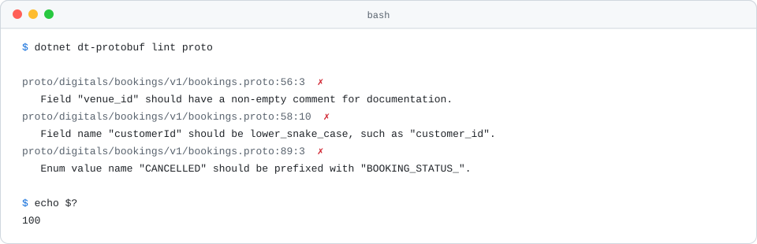
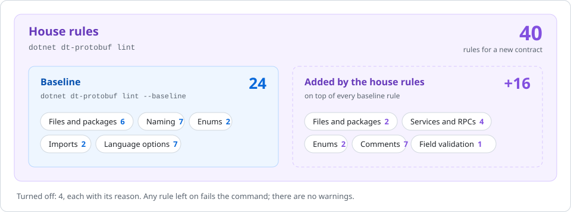

<h1 align="center">Protobuf rules</h1>

<p align="center">Every rule <code>dt-protobuf lint</code> runs on a gRPC contract, why it exists, and what fixes it.</p>

<p align="center">
  
  
  
</p>

<p align="center">
  <a href="#how-to-read-a-rule">How to read a rule</a> ·
  <a href="#the-rules">The rules</a> ·
  <a href="#turned-off">Turned off</a> ·
  <a href="#change-a-rule-for-one-repo">Change a rule</a> ·
  <a href="../../README.md">Back to the README</a>
</p>

<p align="center">
  <picture>
    <source media="(prefers-color-scheme: dark)" srcset="../images/rules-protobuf-dark.svg">
    
  </picture>
</p>

`dt-protobuf lint` runs [buf](https://buf.build) with the Digitals config on a directory of `.proto` files laid out by package, so
`acme.notes.v1` lives in `acme/notes/v1/`. Every rule below is a buf rule: the Digitals rules pick buf's categories,
and the bundled config replaces any `buf.yaml` in the input. A finding prints its file, line and column and the message,
and buf exits 100. Add `--error-format json` to see the rule's name.

The examples edit one small, clean file: a `NoteService` with one RPC, its request and response, a `Note` message and a
`NoteState` enum. [examples/protobuf](../../examples/protobuf) is a full contract that passes every rule.

## Two levels

<p align="center">
  <picture>
    <source media="(prefers-color-scheme: dark)" srcset="../images/rules-protobuf-levels-dark.svg">
    
  </picture>
</p>

| Level | buf categories | Use it for | How |
| --- | --- | --- | --- |
| Baseline | `BASIC` | An existing API: one package per directory, the protobuf style guide's casing, no unused or public imports, matching language options | `--baseline` |
| House rules | `STANDARD` and `COMMENTS` | A new contract: the baseline plus versioned packages, `...Service` names, a request and response message per RPC, prefixed enum values with an `_UNSPECIFIED` zero, and a comment on everything | the default |

The house config also turns off `rpc_allow_google_protobuf_empty_requests` and `rpc_allow_google_protobuf_empty_responses`,
so `google.protobuf.Empty` fails the RPC naming rules like any other shared message.

## How to read a rule

Every rule below has the same parts:

- Two badges.  runs at both levels;  runs only at the default level. The second badge says where the rule comes from: the Digitals rules, OWASP, or the bundled linter.
- Why the rule exists.
- A diff. The red lines fail the rule, the green lines pass it.
- What `dt-protobuf` prints for the red lines, captured by running it. Where a rule can't be shown firing, a note says why.

## The rules

| Topic | Rules |
| --- | --- |
| [Files and packages](#files-and-packages) | [`SYNTAX_SPECIFIED`](#syntax_specified) · [`PACKAGE_DEFINED`](#package_defined) · [`PACKAGE_LOWER_SNAKE_CASE`](#package_lower_snake_case) · [`PACKAGE_VERSION_SUFFIX`](#package_version_suffix) · [`PACKAGE_DIRECTORY_MATCH`](#package_directory_match) · [`DIRECTORY_SAME_PACKAGE`](#directory_same_package) · [`PACKAGE_SAME_DIRECTORY`](#package_same_directory) · [`FILE_LOWER_SNAKE_CASE`](#file_lower_snake_case) |
| [Naming](#naming) | [`MESSAGE_PASCAL_CASE`](#message_pascal_case) · [`FIELD_LOWER_SNAKE_CASE`](#field_lower_snake_case) · [`ONEOF_LOWER_SNAKE_CASE`](#oneof_lower_snake_case) · [`ENUM_PASCAL_CASE`](#enum_pascal_case) · [`ENUM_VALUE_UPPER_SNAKE_CASE`](#enum_value_upper_snake_case) · [`SERVICE_PASCAL_CASE`](#service_pascal_case) · [`RPC_PASCAL_CASE`](#rpc_pascal_case) |
| [Services and RPCs](#services-and-rpcs) | [`SERVICE_SUFFIX`](#service_suffix) · [`RPC_REQUEST_STANDARD_NAME`](#rpc_request_standard_name) · [`RPC_RESPONSE_STANDARD_NAME`](#rpc_response_standard_name) · [`RPC_REQUEST_RESPONSE_UNIQUE`](#rpc_request_response_unique) |
| [Enums](#enums) | [`ENUM_ZERO_VALUE_SUFFIX`](#enum_zero_value_suffix) · [`ENUM_VALUE_PREFIX`](#enum_value_prefix) · [`ENUM_FIRST_VALUE_ZERO`](#enum_first_value_zero) · [`ENUM_NO_ALLOW_ALIAS`](#enum_no_allow_alias) |
| [Comments](#comments) | [`COMMENT_SERVICE`](#comment_service) · [`COMMENT_RPC`](#comment_rpc) · [`COMMENT_MESSAGE`](#comment_message) · [`COMMENT_FIELD`](#comment_field) · [`COMMENT_ONEOF`](#comment_oneof) · [`COMMENT_ENUM`](#comment_enum) · [`COMMENT_ENUM_VALUE`](#comment_enum_value) |
| [Imports](#imports) | [`IMPORT_USED`](#import_used) · [`IMPORT_NO_PUBLIC`](#import_no_public) |
| [Language options](#language-options) | [`PACKAGE_SAME_CSHARP_NAMESPACE`](#package_same_csharp_namespace) · [`PACKAGE_SAME_GO_PACKAGE`](#package_same_go_package) · [`PACKAGE_SAME_JAVA_MULTIPLE_FILES`](#package_same_java_multiple_files) · [`PACKAGE_SAME_JAVA_PACKAGE`](#package_same_java_package) · [`PACKAGE_SAME_PHP_NAMESPACE`](#package_same_php_namespace) · [`PACKAGE_SAME_RUBY_PACKAGE`](#package_same_ruby_package) · [`PACKAGE_SAME_SWIFT_PREFIX`](#package_same_swift_prefix) |
| [Field validation](#field-validation) | [`PROTOVALIDATE`](#protovalidate) |

## Files and packages

### `SYNTAX_SPECIFIED`

 

Every file says which syntax it uses. A file without the line is read as proto2, which has different rules for optional fields and defaults, and nobody reading it can tell.

```diff
  // acme/notes/v1/labels.proto
- package acme.notes.v1;
+ syntax = "proto3";
+
+ package acme.notes.v1;
```

```text
✗ Files must have a syntax explicitly specified. If no syntax is specified, the file defaults to "proto2".
  acme/notes/v1/labels.proto:1:1
  rule: SYNTAX_SPECIFIED
```

### `PACKAGE_DEFINED`

 

Every file declares a package. Without one its types share a global namespace, where any other file can clash with them.

```diff
  syntax = "proto3";

+ package acme.notes.v1;
+
  import "google/protobuf/timestamp.proto";
```

```text
✗ Files must have a package defined.
  acme/notes/v1/notes.proto:1:1
  rule: PACKAGE_DEFINED
```

### `PACKAGE_LOWER_SNAKE_CASE`

 

A package is lower_snake_case parts joined by dots, as the protobuf style guide says. Each language turns it into its own namespace casing, so mixed case in the package comes out wrong somewhere.

```diff
- // acme/Notes/v1/notes.proto
- package acme.Notes.v1;
+ // acme/notes/v1/notes.proto
+ package acme.notes.v1;
```

```text
✗ Package name "acme.Notes.v1" should be lower_snake.case, such as "acme.notes.v1".
  acme/Notes/v1/notes.proto:3:1
  rule: PACKAGE_LOWER_SNAKE_CASE
```

### `PACKAGE_VERSION_SUFFIX`

 

The last part of a package is its major version, `v1` and up. A breaking change then ships as a new package, `acme.notes.v2`, beside the old one, so clients move over when they are ready.

```diff
- // acme/notes/notes.proto
- package acme.notes;
+ // acme/notes/v1/notes.proto
+ package acme.notes.v1;
```

```text
✗ Package name "acme.notes" should be suffixed with a correctly formed version, such as "acme.notes.v1".
  acme/notes/notes.proto:3:1
  rule: PACKAGE_VERSION_SUFFIX
```

### `PACKAGE_DIRECTORY_MATCH`

 

A file lives in the directory its package names: `acme.notes.v1` in `acme/notes/v1/`. Imports are paths, so this is how a reader finds a type from its package, and how buf finds it too.

```diff
- notes/notes.proto
+ acme/notes/v1/notes.proto
```

```text
✗ Files with package "acme.notes.v1" must be within a directory "acme/notes/v1" relative to root but were in directory "notes".
  notes/notes.proto:3:1
  rule: PACKAGE_DIRECTORY_MATCH
```

### `DIRECTORY_SAME_PACKAGE`

 

Every file in a directory has the same package. Two packages in one directory can no longer both match it.

```diff
  // acme/notes/v1/labels.proto
- package acme.labels.v1;
+ package acme.notes.v1;
```

```text
✗ Multiple packages "acme.labels.v1,acme.notes.v1" detected within directory "acme/notes/v1".
  acme/notes/v1/labels.proto:3:1
  rule: DIRECTORY_SAME_PACKAGE
```

### `PACKAGE_SAME_DIRECTORY`

 

All the files of a package sit in one directory. A package split across directories means its imports point to several places, and some generators write it out twice.

```diff
- // acme/notes/v1/labels/labels.proto
+ // acme/notes/v1/labels.proto
  package acme.notes.v1;
```

```text
✗ Multiple directories "acme/notes/v1,acme/notes/v1/labels" contain files with package "acme.notes.v1".
  acme/notes/v1/labels/labels.proto:3:1
  rule: PACKAGE_SAME_DIRECTORY
```

### `FILE_LOWER_SNAKE_CASE`

 

File names are lower_snake_case. They are import paths, so a name like `NoteLabels.proto` breaks on a case-insensitive file system the day someone imports it as `notelabels.proto`.

```diff
- acme/notes/v1/NoteLabels.proto
+ acme/notes/v1/note_labels.proto
```

```text
✗ Filename "NoteLabels.proto" should be lower_snake_case.proto, such as "note_labels.proto".
  acme/notes/v1/NoteLabels.proto:1:1
  rule: FILE_LOWER_SNAKE_CASE
```

## Naming

### `MESSAGE_PASCAL_CASE`

 

Message names are PascalCase, as the style guide says, so the generated classes read naturally in every language.

```diff
  // A label.
- message note_label {
+ message NoteLabel {
    // Its text.
    string text = 1;
  }
```

```text
✗ Message name "note_label" should be PascalCase, such as "NoteLabel".
  acme/notes/v1/notes.proto:38:9
  rule: MESSAGE_PASCAL_CASE
```

### `FIELD_LOWER_SNAKE_CASE`

 

Field names are lower_snake_case. Each language converts them to its own casing, and the JSON name is the lowerCamelCase of it, so `note_title` arrives as `noteTitle` in JSON and in C#, as the HTTP APIs send it.

```diff
  message Note {
    // The note's text, on one line.
-   string noteTitle = 2;
+   string title = 2;
  }
```

```text
✗ Field name "noteTitle" should be lower_snake_case, such as "note_title".
  acme/notes/v1/notes.proto:30:10
  rule: FIELD_LOWER_SNAKE_CASE
```

### `ONEOF_LOWER_SNAKE_CASE`

 

A oneof name is lower_snake_case, like a field, because generated code turns it into a property or a case the same way.

```diff
  // How the note was written.
- oneof Source {
+ oneof source {
    // Typed by a person.
    string author_id = 5;
```

```text
✗ Oneof name "Source" should be lower_snake_case, such as "source".
  acme/notes/v1/notes.proto:36:9
  rule: ONEOF_LOWER_SNAKE_CASE
```

### `ENUM_PASCAL_CASE`

 

Enum names are PascalCase, like messages, because they become types in the generated code.

```diff
  // Where a note is in its lifecycle.
- enum noteState {
+ enum NoteState {
    // Not set. The service never sends it.
    NOTE_STATE_UNSPECIFIED = 0;
```

```text
✗ Enum name "noteState" should be PascalCase, such as "NoteState".
  acme/notes/v1/notes.proto:38:6
  rule: ENUM_PASCAL_CASE
```

### `ENUM_VALUE_UPPER_SNAKE_CASE`

 

Enum values are UPPER_SNAKE_CASE. They are constants in most generated code, and the JSON form sends the name as written.

```diff
  enum NoteState {
-   NOTE_STATE_Active = 1;
+   NOTE_STATE_ACTIVE = 1;
  }
```

```text
✗ Enum value name "NOTE_STATE_Active" should be UPPER_SNAKE_CASE, such as "NOTE_STATE_ACTIVE".
  acme/notes/v1/notes.proto:42:3
  rule: ENUM_VALUE_UPPER_SNAKE_CASE
```

### `SERVICE_PASCAL_CASE`

 

Service names are PascalCase. The name becomes the client and server classes and part of every RPC's path, `/acme.notes.v1.NoteService/GetNote`.

```diff
  // Keeps short single-line notes.
- service noteService {
+ service NoteService {
```

```text
✗ Service name "noteService" should be PascalCase, such as "NoteService".
  acme/notes/v1/notes.proto:8:9
  rule: SERVICE_PASCAL_CASE
```

### `RPC_PASCAL_CASE`

 

RPC names are PascalCase verbs and nouns, `GetNote`, as the style guide says. The name becomes a method in every generated client and part of the call's path.

```diff
  service NoteService {
-   rpc getNote(GetNoteRequest) returns (GetNoteResponse);
+   rpc GetNote(GetNoteRequest) returns (GetNoteResponse);
  }
```

```text
✗ RPC name "getNote" should be PascalCase, such as "GetNote".
  acme/notes/v1/notes.proto:10:7
  rule: RPC_PASCAL_CASE
```

## Services and RPCs

### `SERVICE_SUFFIX`

 

A service name ends in `Service`, so `NoteService` can't be mistaken for the `Note` message in generated code.

```diff
  // Keeps short single-line notes.
- service Notes {
+ service NoteService {
```

```text
✗ Service name "Notes" should be suffixed with "Service".
  acme/notes/v1/notes.proto:8:9
  rule: SERVICE_SUFFIX
```

### `RPC_REQUEST_STANDARD_NAME`

 

Every RPC takes its own request message, named after it: `GetNote` takes `GetNoteRequest`. A field added for one RPC then can't change another. The config turns off `rpc_allow_google_protobuf_empty_requests`, so `google.protobuf.Empty` fails this rule too: it can never gain a field.

```diff
  service NoteService {
-   rpc GetNote(NoteQuery) returns (GetNoteResponse);
+   rpc GetNote(GetNoteRequest) returns (GetNoteResponse);
  }
```

```text
✗ RPC request type "NoteQuery" should be named "GetNoteRequest" or "NoteServiceGetNoteRequest".
  acme/notes/v1/notes.proto:10:15
  rule: RPC_REQUEST_STANDARD_NAME
```

### `RPC_RESPONSE_STANDARD_NAME`

 

Every RPC returns its own response message, named after it: `GetNote` returns `GetNoteResponse`, never the `Note` itself. The response can then gain a field, such as a page token, without breaking anything. `rpc_allow_google_protobuf_empty_responses` is off too, so an RPC that has nothing to say still returns an empty `DeleteNoteResponse` of its own.

```diff
  service NoteService {
-   rpc GetNote(GetNoteRequest) returns (Note);
+   rpc GetNote(GetNoteRequest) returns (GetNoteResponse);
  }
```

```text
✗ RPC response type "Note" should be named "GetNoteResponse" or "NoteServiceGetNoteResponse".
  acme/notes/v1/notes.proto:10:40
  rule: RPC_RESPONSE_STANDARD_NAME
```

> **Note:** `google.protobuf.Empty` as a request or response fails both naming rules, and `RPC_REQUEST_RESPONSE_UNIQUE` when it is both:
>
> ```text
> ✗ RPC "GetNote" has the same type "google.protobuf.Empty" for the request and response.
>   rule: RPC_REQUEST_RESPONSE_UNIQUE
> ✗ RPC request type "Empty" should be named "GetNoteRequest" or "NoteServiceGetNoteRequest".
>   rule: RPC_REQUEST_STANDARD_NAME
> ✗ RPC response type "Empty" should be named "GetNoteResponse" or "NoteServiceGetNoteResponse".
>   rule: RPC_RESPONSE_STANDARD_NAME
> ```

### `RPC_REQUEST_RESPONSE_UNIQUE`

 

A request or response message belongs to one RPC. Two RPCs sharing `GetNoteRequest` can't change it apart, so the second RPC gets its own pair even when today they look the same.

```diff
  service NoteService {
    rpc GetNote(GetNoteRequest) returns (GetNoteResponse);
-   rpc GetLatestNote(GetNoteRequest) returns (GetNoteResponse);
+   rpc GetLatestNote(GetLatestNoteRequest) returns (GetLatestNoteResponse);
  }
```

```text
✗ "acme.notes.v1.GetNoteRequest" is used as the request or response type for multiple RPCs.
  acme/notes/v1/notes.proto:10:3
  rule: RPC_REQUEST_RESPONSE_UNIQUE
```

## Enums

### `ENUM_ZERO_VALUE_SUFFIX`

 

The zero value of an enum ends in `_UNSPECIFIED`. Zero is what a reader sees when the field was never set, so it must mean "not set", never a real state.

```diff
  enum NoteState {
    // Not set. The service never sends it.
-   NOTE_STATE_UNKNOWN = 0;
+   NOTE_STATE_UNSPECIFIED = 0;
```

```text
✗ Enum zero value name "NOTE_STATE_UNKNOWN" should be suffixed with "_UNSPECIFIED".
  acme/notes/v1/notes.proto:40:3
  rule: ENUM_ZERO_VALUE_SUFFIX
```

### `ENUM_VALUE_PREFIX`

 

Every value starts with the enum's name in UPPER_SNAKE_CASE: `NOTE_STATE_ACTIVE`. Enum values share their package's scope, so two enums with an `ACTIVE` value in one package don't compile.

```diff
  enum NoteState {
-   ACTIVE = 1;
+   NOTE_STATE_ACTIVE = 1;
  }
```

```text
✗ Enum value name "ACTIVE" should be prefixed with "NOTE_STATE_".
  acme/notes/v1/notes.proto:42:3
  rule: ENUM_VALUE_PREFIX
```

### `ENUM_FIRST_VALUE_ZERO`

 

The first value of an enum is zero. proto3 requires it already; this catches a proto2 file, where a field that was never set would otherwise read as the first real value.

```diff
  // labels.proto, syntax = "proto2"
  enum Colour {
-   COLOUR_RED = 1;
+   COLOUR_UNSPECIFIED = 0;
+   COLOUR_RED = 1;
  }
```

```text
✗ First enum value "COLOUR_RED" should have a numeric value of 0
  acme/notes/v1/labels.proto:8:16
  rule: ENUM_FIRST_VALUE_ZERO
```

### `ENUM_NO_ALLOW_ALIAS`

 

No two enum values share a number. With `allow_alias`, JSON and every generated `ToString` pick one name for the number, so the name a client sent may not be the name it gets back.

```diff
  enum NoteState {
-   option allow_alias = true;
    NOTE_STATE_UNSPECIFIED = 0;
    NOTE_STATE_ACTIVE = 1;
-   NOTE_STATE_SHOWN = 1;
  }
```

```text
✗ Enum option "allow_alias" on enum "NoteState" must be false.
  acme/notes/v1/notes.proto:39:3
  rule: ENUM_NO_ALLOW_ALIAS
```

## Comments

### `COMMENT_SERVICE`

 

Every service has a comment above it. The comment is the documentation: `dt-protobuf docs` and the generated code show it, and it is the only place to say what the service means. This is the `.proto` side of `dt-description` in the HTTP rules.

```diff
+ // Keeps short single-line notes.
  service NoteService {
```

```text
✗ Service "NoteService" should have a non-empty comment for documentation.
  acme/notes/v1/notes.proto:7:1
  rule: COMMENT_SERVICE
```

### `COMMENT_RPC`

 

Every RPC has a comment above it. The comment is the documentation: `dt-protobuf docs` and the generated code show it, and it is the only place to say what the RPC means. This is the `.proto` side of `dt-description` in the HTTP rules.

```diff
  service NoteService {
+   // Reads one note by the id the service assigned when it was created.
    rpc GetNote(GetNoteRequest) returns (GetNoteResponse);
```

```text
✗ RPC "GetNote" should have a non-empty comment for documentation.
  acme/notes/v1/notes.proto:9:3
  rule: COMMENT_RPC
```

### `COMMENT_MESSAGE`

 

Every message has a comment above it. The comment is the documentation: `dt-protobuf docs` and the generated code show it, and it is the only place to say what the message means. This is the `.proto` side of `dt-description` in the HTTP rules.

```diff
+ // A note as the service stores it.
  message Note {
```

```text
✗ Message "Note" should have a non-empty comment for documentation.
  acme/notes/v1/notes.proto:25:1
  rule: COMMENT_MESSAGE
```

### `COMMENT_FIELD`

 

Every field has a comment above it. The comment is the documentation: `dt-protobuf docs` and the generated code show it, and it is the only place to say what the field means. This is the `.proto` side of `dt-description` in the HTTP rules.

```diff
  message Note {
+   // The note's text, on one line.
    string title = 2;
```

```text
✗ Field "title" should have a non-empty comment for documentation.
  acme/notes/v1/notes.proto:29:3
  rule: COMMENT_FIELD
```

### `COMMENT_ONEOF`

 

Every oneof has a comment above it. The comment is the documentation: `dt-protobuf docs` and the generated code show it, and it is the only place to say what the oneof means. This is the `.proto` side of `dt-description` in the HTTP rules.

```diff
  message Note {
+   // How the note was written.
    oneof source {
```

```text
✗ Oneof "source" should have a non-empty comment for documentation.
  acme/notes/v1/notes.proto:35:3
  rule: COMMENT_ONEOF
```

### `COMMENT_ENUM`

 

Every enum has a comment above it. The comment is the documentation: `dt-protobuf docs` and the generated code show it, and it is the only place to say what the enum means. This is the `.proto` side of `dt-description` in the HTTP rules.

```diff
+ // Where a note is in its lifecycle.
  enum NoteState {
```

```text
✗ Enum "NoteState" should have a non-empty comment for documentation.
  acme/notes/v1/notes.proto:37:1
  rule: COMMENT_ENUM
```

### `COMMENT_ENUM_VALUE`

 

Every enum value has a comment above it. The comment is the documentation: `dt-protobuf docs` and the generated code show it, and it is the only place to say what the enum value means. This is the `.proto` side of `dt-description` in the HTTP rules.

```diff
  enum NoteState {
+   // Shown in lists.
    NOTE_STATE_ACTIVE = 1;
```

```text
✗ Enum value "NOTE_STATE_ACTIVE" should have a non-empty comment for documentation.
  acme/notes/v1/notes.proto:41:3
  rule: COMMENT_ENUM_VALUE
```

## Imports

### `IMPORT_USED`

 

Every import is used. An unused import still has to resolve, so it keeps a dependency alive that nothing needs.

```diff
  import "google/protobuf/timestamp.proto";
- import "google/protobuf/duration.proto";
```

```text
✗ Import "google/protobuf/duration.proto" is unused.
  acme/notes/v1/notes.proto:6:1
  rule: IMPORT_USED
```

### `IMPORT_NO_PUBLIC`

 

No `import public`. It re-exports another file's types, so a file seems to define types it doesn't, and several languages' generators don't support it.

```diff
- import public "google/protobuf/timestamp.proto";
+ import "google/protobuf/timestamp.proto";
```

```text
✗ Import "google/protobuf/timestamp.proto" must not be public.
  acme/notes/v1/notes.proto:5:1
  rule: IMPORT_NO_PUBLIC
```

## Language options

### `PACKAGE_SAME_CSHARP_NAMESPACE`

 

Every file in a package sets `csharp_namespace` to the same value, or none does. Otherwise one package's types land in two places in the generated code, and a type in one file can't see a type in the other.

```diff
  // acme/notes/v1/notes.proto
  option csharp_namespace = "Acme.Notes.V1";

  // acme/notes/v1/labels.proto
- option csharp_namespace = "Acme.Labels";
+ option csharp_namespace = "Acme.Notes.V1";
```

```text
✗ Files in package "acme.notes.v1" have multiple values "Acme.Labels,Acme.Notes.V1" for option "csharp_namespace" and all values must be equal.
  acme/notes/v1/labels.proto:5:1
  rule: PACKAGE_SAME_CSHARP_NAMESPACE
```

### `PACKAGE_SAME_GO_PACKAGE`

 

Every file in a package sets `go_package` to the same value, or none does. Otherwise one package's types land in two places in the generated code, and a type in one file can't see a type in the other.

```diff
  // acme/notes/v1/notes.proto
  option go_package = "example.com/acme/notes/v1;notesv1";

  // acme/notes/v1/labels.proto
- option go_package = "example.com/acme/labels";
+ option go_package = "example.com/acme/notes/v1;notesv1";
```

```text
✗ Files in package "acme.notes.v1" have multiple values "example.com/acme/labels,example.com/acme/notes/v1;notesv1" for option "go_package" and all values must be equal.
  acme/notes/v1/labels.proto:5:1
  rule: PACKAGE_SAME_GO_PACKAGE
```

### `PACKAGE_SAME_JAVA_MULTIPLE_FILES`

 

Every file in a package sets `java_multiple_files` to the same value, or none does. Otherwise one package's types land in two places in the generated code, and a type in one file can't see a type in the other.

```diff
  // acme/notes/v1/notes.proto
  option java_multiple_files = true;

  // acme/notes/v1/labels.proto
- option java_multiple_files = false;
+ option java_multiple_files = true;
```

```text
✗ Files in package "acme.notes.v1" have multiple values "false,true" for option "java_multiple_files" and all values must be equal.
  acme/notes/v1/labels.proto:5:1
  rule: PACKAGE_SAME_JAVA_MULTIPLE_FILES
```

### `PACKAGE_SAME_JAVA_PACKAGE`

 

Every file in a package sets `java_package` to the same value, or none does. Otherwise one package's types land in two places in the generated code, and a type in one file can't see a type in the other.

```diff
  // acme/notes/v1/notes.proto
  option java_package = "com.acme.notes.v1";

  // acme/notes/v1/labels.proto
- option java_package = "com.acme.labels";
+ option java_package = "com.acme.notes.v1";
```

```text
✗ Files in package "acme.notes.v1" have multiple values "com.acme.labels,com.acme.notes.v1" for option "java_package" and all values must be equal.
  acme/notes/v1/labels.proto:5:1
  rule: PACKAGE_SAME_JAVA_PACKAGE
```

### `PACKAGE_SAME_PHP_NAMESPACE`

 

Every file in a package sets `php_namespace` to the same value, or none does. Otherwise one package's types land in two places in the generated code, and a type in one file can't see a type in the other.

```diff
  // acme/notes/v1/notes.proto
  option php_namespace = "Acme\\Notes\\V1";

  // acme/notes/v1/labels.proto
- option php_namespace = "Acme\\Labels";
+ option php_namespace = "Acme\\Notes\\V1";
```

```text
✗ Files in package "acme.notes.v1" have multiple values "Acme\\Labels,Acme\\Notes\\V1" for option "php_namespace" and all values must be equal.
  acme/notes/v1/labels.proto:5:1
  rule: PACKAGE_SAME_PHP_NAMESPACE
```

### `PACKAGE_SAME_RUBY_PACKAGE`

 

Every file in a package sets `ruby_package` to the same value, or none does. Otherwise one package's types land in two places in the generated code, and a type in one file can't see a type in the other.

```diff
  // acme/notes/v1/notes.proto
  option ruby_package = "Acme::Notes::V1";

  // acme/notes/v1/labels.proto
- option ruby_package = "Acme::Labels";
+ option ruby_package = "Acme::Notes::V1";
```

```text
✗ Files in package "acme.notes.v1" have multiple values "Acme::Labels,Acme::Notes::V1" for option "ruby_package" and all values must be equal.
  acme/notes/v1/labels.proto:5:1
  rule: PACKAGE_SAME_RUBY_PACKAGE
```

### `PACKAGE_SAME_SWIFT_PREFIX`

 

Every file in a package sets `swift_prefix` to the same value, or none does. Otherwise one package's types land in two places in the generated code, and a type in one file can't see a type in the other.

```diff
  // acme/notes/v1/notes.proto
  option swift_prefix = "ACN";

  // acme/notes/v1/labels.proto
- option swift_prefix = "ACL";
+ option swift_prefix = "ACN";
```

```text
✗ Files in package "acme.notes.v1" have multiple values "ACL,ACN" for option "swift_prefix" and all values must be equal.
  acme/notes/v1/labels.proto:5:1
  rule: PACKAGE_SAME_SWIFT_PREFIX
```

## Field validation

### `PROTOVALIDATE`

 

A field's [protovalidate](https://protovalidate.com) rules are valid and every CEL expression compiles, so a rule that can never pass, or can't run, fails at lint instead of on the first request.

```diff
  import "buf/validate/validate.proto";

  message Note {
    // The note's text, on one line.
-   string title = 2 [(buf.validate.field).string.min_len = 10, (buf.validate.field).string.max_len = 5];
+   string title = 2 [(buf.validate.field).string.max_len = 200];
  }
```

> **Note:** This page has no captured message for this rule. It only runs on a file that imports `buf/validate/validate.proto`, which resolves only when the module depends on `buf.build/bufbuild/protovalidate` and buf can fetch it. The rules here are checked offline.

## Turned off

These are the buf lint rules outside `BASIC`, `STANDARD` and `COMMENTS`. buf lists them with `buf config ls-lint-rules --version v1 --include-deprecated`.

| Rule | Why it is off |
| --- | --- |
| `RPC_NO_CLIENT_STREAMING` | In `UNARY_RPC`. A contract may stream from the client, as `AddAttachment` in the example does. |
| `RPC_NO_SERVER_STREAMING` | In `UNARY_RPC`. A contract may stream to the client, as `GetAttachment` and `WatchBookings` in the example do. |
| `PACKAGE_NO_IMPORT_CYCLE` | In no category, so buf runs it only when a config names it, and the Digitals config doesn't. Two packages that import each other compile, so nothing else catches it. |
| `IMPORT_NO_WEAK` | Deprecated in buf, which no longer lists it. |

## Breaking changes

`dt-protobuf breaking <base> <revision>` fails on any change that breaks code generated from `base`. Both levels use
buf's `FILE` category, the strictest: it also covers every change that breaks the wire format or the JSON format.
`base` is usually main: a directory, or a git ref such as `.git#branch=main`.

```diff
  message Note {
    // Assigned by the service on create.
    string note_id = 1;
-   // The note's text, on one line.
-   string title = 2;
    // When the service created the note.
    google.protobuf.Timestamp create_time = 3;
```

```console
$ dotnet dt-protobuf breaking main proto
proto/acme/notes/v1/notes.proto:26:1:Previously present field "2" with name "title" on message "Note" was deleted.
$ echo $?
100
```

To retire a field, mark it `[deprecated = true]` first. When it does go, `reserved 2; reserved "title";` stops anyone reusing
its number or name, though removing it still fails this check: code generated from the old file loses a property.

The `FILE` rules, in buf's order:

| Rule | Fails when the revision |
| --- | --- |
| `ENUM_NO_DELETE` | deletes an enum from a file |
| `FILE_NO_DELETE` | deletes a file |
| `MESSAGE_NO_DELETE` | deletes a message from a file |
| `SERVICE_NO_DELETE` | deletes a service from a file |
| `ENUM_SAME_TYPE` | turns an open enum closed, or a closed one open |
| `ENUM_VALUE_NO_DELETE` | deletes an enum value |
| `EXTENSION_MESSAGE_NO_DELETE` | deletes an extension range from a message |
| `FIELD_NO_DELETE` | deletes a field from a message |
| `FIELD_SAME_CARDINALITY` | makes a field repeated, optional or required when it wasn't, or the reverse |
| `FIELD_SAME_CPP_STRING_TYPE` | changes a field's C++ string type (`ctype`, or the `string_type` feature) |
| `FIELD_SAME_JAVA_UTF8_VALIDATION` | changes whether Java checks a string field is UTF-8 |
| `FIELD_SAME_JSTYPE` | changes a field's `jstype`, so JavaScript reads a number as a string or the reverse |
| `FIELD_SAME_TYPE` | changes a field's type |
| `FIELD_SAME_UTF8_VALIDATION` | changes whether a string field is checked to be UTF-8 |
| `FILE_SAME_CC_ENABLE_ARENAS` | changes `cc_enable_arenas` |
| `FILE_SAME_CC_GENERIC_SERVICES` | changes `cc_generic_services` |
| `FILE_SAME_CSHARP_NAMESPACE` | changes `csharp_namespace`, which moves the generated C# types |
| `FILE_SAME_GO_PACKAGE` | changes `go_package` |
| `FILE_SAME_JAVA_GENERIC_SERVICES` | changes `java_generic_services` |
| `FILE_SAME_JAVA_MULTIPLE_FILES` | changes `java_multiple_files` |
| `FILE_SAME_JAVA_OUTER_CLASSNAME` | changes `java_outer_classname` |
| `FILE_SAME_JAVA_PACKAGE` | changes `java_package` |
| `FILE_SAME_OBJC_CLASS_PREFIX` | changes `objc_class_prefix` |
| `FILE_SAME_OPTIMIZE_FOR` | changes `optimize_for` |
| `FILE_SAME_PHP_CLASS_PREFIX` | changes `php_class_prefix` |
| `FILE_SAME_PHP_METADATA_NAMESPACE` | changes `php_metadata_namespace` |
| `FILE_SAME_PHP_NAMESPACE` | changes `php_namespace` |
| `FILE_SAME_PY_GENERIC_SERVICES` | changes `py_generic_services` |
| `FILE_SAME_RUBY_PACKAGE` | changes `ruby_package` |
| `FILE_SAME_SWIFT_PREFIX` | changes `swift_prefix` |
| `FILE_SAME_SYNTAX` | changes a file's syntax or edition |
| `MESSAGE_NO_REMOVE_STANDARD_DESCRIPTOR_ACCESSOR` | sets `no_standard_descriptor_accessor` on a message that didn't have it |
| `ONEOF_NO_DELETE` | deletes a oneof from a message |
| `RPC_NO_DELETE` | deletes an RPC from a service |
| `ENUM_SAME_JSON_FORMAT` | changes whether an enum supports the JSON format |
| `ENUM_VALUE_SAME_NAME` | renames an enum value, which JSON sends by name |
| `FIELD_SAME_JSON_NAME` | changes a field's `json_name` |
| `FIELD_SAME_NAME` | renames a field, which JSON sends by name |
| `MESSAGE_SAME_JSON_FORMAT` | changes whether a message supports the JSON format |
| `FIELD_SAME_ONEOF` | moves a field into a oneof, out of one, or to another |
| `FILE_SAME_PACKAGE` | changes a file's package |
| `MESSAGE_SAME_REQUIRED_FIELDS` | adds or deletes a required field (proto2 or editions) |
| `RESERVED_ENUM_NO_DELETE` | deletes a reserved number or name from an enum |
| `RESERVED_MESSAGE_NO_DELETE` | deletes a reserved number or name from a message |
| `RPC_SAME_CLIENT_STREAMING` | makes an RPC client-streaming, or stops it |
| `RPC_SAME_IDEMPOTENCY_LEVEL` | changes an RPC's `idempotency_level` |
| `RPC_SAME_REQUEST_TYPE` | changes an RPC's request message |
| `RPC_SAME_RESPONSE_TYPE` | changes an RPC's response message |
| `RPC_SAME_SERVER_STREAMING` | makes an RPC server-streaming, or stops it |

## Change a rule for one repo

Write the config next to your contract, change it, and pass it back with `--config`. buf has no `extends`, so the file
holds the whole config:

```bash
dotnet dt-protobuf ruleset buf.yaml
dotnet dt-protobuf lint proto --config buf.yaml
dotnet dt-protobuf breaking .git#branch=main proto --config buf.yaml
```

```yaml
version: v1
lint:
  use:
    - STANDARD
    - COMMENTS
  except:
    - COMMENT_ENUM_VALUE      # why
  rpc_allow_google_protobuf_empty_requests: false
  rpc_allow_google_protobuf_empty_responses: false
breaking:
  use:
    - FILE
```

To skip a rule for some files only, list them under `ignore_only` instead of `except`:

```yaml
lint:
  ignore_only:
    COMMENT_FIELD:
      - acme/notes/v1/legacy.proto
```

A `// buf:lint:ignore` comment does nothing: a v1 config needs `allow_comment_ignores: true` for that, and the Digitals config
leaves it off. Keep the version `v1`: buf reads a v1 file passed by `--config` as the config for whatever input it lints.
